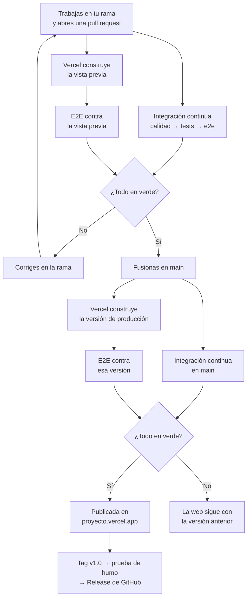

# Contexto para el agente · Proyecto «Huellas» (DWEC, 2.º DAW)

Actualizado el 2026-11-12. Este fichero reúne **todo** lo que una persona o un asistente (otra IA, otro ordenador u otra sesión) necesita para seguir el proyecto exactamente donde está y con el mismo método, o para recrearlo desde cero. Está dentro del repositorio: se versiona con el proyecto y se mantiene al día con él, tarjeta a tarjeta.

## 0. Cómo usar este fichero

1. Lee entero este apartado 0 y los apartados 1 a 5: son el resumen operativo.
2. Después lee los anexos, que son la copia literal de los ficheros de memoria. Si el resumen y un anexo no coinciden, manda el anexo «Cuaderno del proyecto»; si el cuaderno y Trello no coinciden, manda Trello.
3. Los enlaces `[[nombre]]` de los anexos se refieren a otros anexos de este mismo fichero (el nombre es el del fichero de memoria sin `.md`).
4. Antes de afirmar algo sobre el código, compruébalo en el repositorio: esto es una foto del 2026-11-12.
5. Al terminar cada tarjeta, actualiza este fichero: el estado del apartado 2 y la bitácora del anexo «Cuaderno del proyecto» (y su apartado «En qué paso vamos»). Si cambia algo de fondo, también el resumen. El detalle está en el apartado 5.

## 1. Quién es el usuario y qué se hace

- Estudiante de 2.º de DAW. Usuario de GitHub `Javi7142`, correo de commits `jhonbar1407@g.educaand.es`. Se le habla en español, breve y sin jerga.
- Proyecto de Desarrollo Web en Entorno Cliente: **Huellas**, aplicación de gestión de una protectora de animales en JavaScript puro (solo el CSS de Bootstrap, sin frameworks ni APIs remotas), con tests (Vitest y Playwright), CI en GitHub Actions y CD en Vercel. Más adelante pasará a Angular.
- Tres sprints: `v0.1` (12 nov 2026, **cerrado**), `v0.2` (19 nov 2026) y `v1.0` (26 nov 2026, la única versión que se corrige). Se defiende en una exposición individual: el usuario tiene que poder explicar cada parte.
- Repositorio (entrega, público): https://github.com/fpftoro-docencia/dwec-2dawt-2627-proyectodomeval-javi7142
- Tablero de Trello: https://trello.com/b/P3FzyJnK/huellas-proyecto-dom-protectora-de-animales

## 2. Estado a 2026-11-12

- **Sprint 1 cerrado**, tag `v0.1` sobre `bc0be75`. Después entraron el arreglo S1-14b (PR 28, `5d624a4`), este fichero de contexto (S1-20b, rama `contexto-agente`, PR 29) y las definiciones de los agentes de trabajo (S1-20c, rama `agentes-de-trabajo`, PR 30). Estas dos últimas no cambian el código de la aplicación.
- **Desde el 2026-11-12 se trabaja con agentes** (apartado 4): un coordinador y tres agentes definidos en `.claude/agents/` (desarrollador, probador e integrador).
- **Sprint 2 en marcha** (entrega el 19 de noviembre). **S2-01 · Definir la entidad Animal**, hecha (rama `entidad-animal`, PR 31): tabla «La entidad» del README cerrada, letra de control en el DNI del adoptante y los `@typedef` `Animal`, `Vacuna` y `Adopcion` en `js/datos/animales.js`, todavía sin funciones (llegan en S2-04).
- La PR 1 «Feedback» y la rama `feedback` son de Classroom: **no se tocan**.
- Después, S1-20d (rama `agentes-paralelo`, PR 32): reglas para gestionar los agentes (en paralelo, solo cuando hacen falta, agentes extra y control de calidad; apartado 4).
- Después, S1-20e (rama `puerto-fijo`): la web siempre en `http://localhost:3901`, para que las cuentas guardadas no «desaparezcan» (regla 11 y apartado 5, punto 3).
- **S2-02 · Validadores de nombre, microchip y teléfono**, hecha (rama `validadores-ficha`, PR 34): `validarNombre`, `validarMicrochip` y `validarTelefono` en `js/logica/validadores.js`, elegibles por `data-validar`.
- **S2-03 · Validador con letra de control**, hecha (rama `validador-dni`, PR 35): `validarDni` y `letraDni` en `js/logica/validadores.js`.
- **Siguiente tarjeta: S2-04 · Módulo de animales.** No está empezada y no se empieza hasta que el usuario lo diga.
- Funciona: registro, inicio de sesión, roles (el primer registrado es administrador), cabecera, protección por sesión y por rol (sin parpadeo), cierre de sesión y avisos. 96 tests en `npm test`. CI `Calidad` → `Tests`.
- Tareas que solo puede hacer el usuario: nombrar las etiquetas de Trello, compartir el tablero con el profesor, contar en el README un problema real resuelto con el depurador de DevTools, leer el blog y la reflexión que se escribieron en su nombre, y crear y configurar Vercel (S3-01, S3-02).

## 3. Reglas que no se rompen

1. **No adelantar trabajo.** Trello en orden, tarjeta a tarjeta. Nada que no pida la tarjeta en curso. No se empieza ninguna tarjeta sin que el usuario lo diga («Sí, S2-01»). Si falta algo, se crea o se modifica una tarjeta, no se hace por libre.
2. **Una rama por tarjeta, una PR por rama, fusión con *merge*.** No se borran ramas. No se renombran ramas con PR abierta (cierra la PR).
3. **Autoría solo del usuario.** Commits, PR y comentarios a nombre de `Javi7142 <jhonbar1407@g.educaand.es>`, sin coautoría ni mención a ninguna IA.
4. **Los agentes hacen solos commits, push, PR y fusiones**, sin preguntar, pero **nunca** sin pasar antes la Definición de Hecho, sin el APTO del probador y sin la CI (`Calidad` y `Tests`) en verde.
5. **Datos siempre inventados** (DNI, teléfonos, nombres, correos): el repositorio es público.
6. **Código:** sin frameworks; el JS nunca escribe estilos (solo clases, `hidden`, `data-*`, `aria-*`, `disabled`); sin `innerHTML` con datos; sin atributos `on…` ni `style=""` en el HTML; sin JS de Bootstrap; JS sencillo que el usuario pueda explicar; JSDoc en español.
7. **Ficheros que no se modifican:** `js/clave.js`, `scripts/construir.js`, `.devcontainer/`, `playwright.config.js`, `serve.json`, `jsdoc.json`. Los títulos `##` del README no cambian de nombre (la corrección los busca).
8. **Blog y reflexiones** los escribe el asistente en nombre del usuario, solo con hechos reales del proyecto.
9. **Al contestar:** breve, en español, qué hace lo nuevo, cómo probarlo y cuál es la siguiente tarjeta. **No explicar cómo se ha comprobado.**
10. **Diseño:** web original y profesional («En azul y amarillo»), no un CRUD de plantilla; enseñar los cambios visuales antes de confirmarlos.
11. **La web se abre siempre en `http://localhost:3901`.** Las cuentas (y, desde S2-04, los animales) se guardan en el `localStorage` de esa dirección exacta, con su puerto: en `localhost:3902` el navegador ve otra web, vacía. Ni las pruebas ni los agentes publican puertos en el equipo: sus servidores van en el 3903, dentro de su propio contenedor.

## 4. Método de cada tarjeta, con agentes (el detalle está en los anexos «Flujo de trabajo» y «Agentes de trabajo»)

Desde el 2026-11-12, a petición del usuario, el trabajo se reparte entre agentes. El método y las comprobaciones son **exactamente los mismos** que en el sprint 1; solo cambia quién hace cada paso.

| Papel | Modelo y esfuerzo | Definición | Qué hace |
| --- | --- | --- | --- |
| **Coordinador** | el de la sesión principal | este fichero y la memoria | Lee el cuaderno y Trello, mueve la tarjeta a «Haciendo», elige agente, escribe los encargos, revisa diffs e informes, enseña los cambios visuales al usuario, mantiene la memoria y este fichero, y contesta al usuario. Crea agentes extra cuando compensa |
| **desarrollador** | Claude Opus 5.5, esfuerzo alto | `.claude/agents/desarrollador.md` | Lee todo (este fichero, memoria, Trello, demo) y programa la tarjeta en su rama con commits pequeños; se pasa la Definición de Hecho. Sin `push`, PR ni Trello |
| **probador** | Claude Opus 5.5, esfuerzo medio | `.claude/agents/probador.md` | Hace las tarjetas de tests (Vitest, happy-dom, E2E con Playwright, cobertura) y comprueba cada tarjeta de forma independiente: «Hecho cuando» en Chromium, Firefox y WebKit, regresión y Definición de Hecho → APTO o NO APTO |
| **integrador** | Claude Sonnet 5.5, esfuerzo medio | `.claude/agents/integrador.md` | Mueve las tarjetas de Trello, añade la fila de la rama al README, sube la rama, abre la PR, espera la CI en verde y fusiona con *merge*; tags al cerrar sprint |

Pasos de cada tarjeta:

1. **Coordinador:** cuando el usuario lo dice, lee el cuaderno y la tarjeta (descripción y comentarios: «Qué hay que hacer», «Dependencias», «Hecho cuando»). Tarjeta de tests → probador; el resto → desarrollador.
2. **Coordinador** mueve la tarjeta a «Haciendo» (es un solo paso: no se lanza un agente para eso) y, a la vez, **desarrollador** (o probador) hace `git checkout main`, `git pull`, `git checkout -b <rama-descriptiva>`. Si compensa, el **probador** se lanza ya en paralelo para escribir su script a partir del «Hecho cuando».
3. **Desarrollador:** hace solo lo que pide, con inyección de dependencias (almacén, `navegar`, `resumir` como parámetros), commits pequeños a nombre del usuario y la Definición de Hecho pasada.
4. **Probador:** comprueba el «Hecho cuando» con un script propio fuera del repositorio (Playwright en Chromium, Firefox y WebKit), pasa los scripts de tarjetas anteriores que toquen lo mismo y la Definición de Hecho: `npm run format:check`, `npm run lint`, `npm test`, `npm run docs` y `npm run build` sin errores; busca `console.log`, `TODO`, `var`, `==`, `innerHTML` y `.style`; README al día.
5. **Coordinador:** si es NO APTO, devuelve los fallos al mismo desarrollador y se repite el paso 4. Con APTO, revisa el diff, enseña al usuario los cambios visuales, actualiza la memoria y este fichero (commit en la misma rama).
6. **Integrador** (modo «cerrar»): fila de la rama en la tabla «Ramas y versiones» del README con el enlace a su PR, `git push -u`, `gh pr create` con título «… (Sx-nn)», CI en verde, `gh pr merge --merge`, `main` local al día y tarjeta al final de «Hecho».
7. **Coordinador:** comprueba la PR fusionada y contesta al usuario en breve (qué hace lo nuevo, cómo probarlo, cuál es la siguiente tarjeta), sin explicar cómo se ha comprobado.

Si los agentes de `.claude/agents/` no están disponibles (se cargan al arrancar la sesión, y solo en Claude Code), se lanza un agente general con el modelo y el esfuerzo de la tabla y se le pide que siga el fichero de su papel. Con otra herramienta de IA, los tres ficheros sirven igual como instrucciones de cada papel.

### Cómo se gestionan los agentes (pedido por el usuario el 2026-11-12, S1-20d)

El objetivo es la máxima velocidad y el mayor porcentaje de éxito gastando menos tokens que con un solo agente.

1. **En paralelo cuando se puede.** Se lanzan a la vez los agentes cuyas tareas no dependen una de otra ni tocan los mismos ficheros: por ejemplo, el desarrollador programa mientras el probador escribe su script; o, en una tarjeta grande, dos desarrolladores con piezas independientes, cada uno en su propio *worktree*, que luego se juntan en la rama. Nunca dos agentes escribiendo los mismos ficheros, y siempre dentro de la tarjeta en curso: no se adelantan tarjetas.
2. **Solo cuando hacen falta.** Cada agente que arranca relee el contexto y eso cuesta. Lo de pocos pasos lo hace el coordinador: mover una tarjeta, un comentario en Trello, mirar un diff, una línea de la memoria. En S2-01 el integrador gastó unos 65 000 tokens solo en mover la tarjeta a «Haciendo»; desde entonces lo hace el coordinador. Si un agente ya tiene el contexto, se le sigue hablando a él en vez de lanzar otro.
3. **Agentes extra cuando compensa.** Además de los tres principales, el coordinador puede crear otros:

| Necesidad | Agente | Modelo |
| --- | --- | --- |
| Buscar en muchos ficheros cuando solo interesa la conclusión | Explorador (solo lectura) | rápido y barato |
| Diseñar una tarjeta grande antes de programarla | Planificador | Opus |
| Tarea mecánica y repetitiva (renombrar en muchos sitios, rellenar tablas, regenerar textos) | General | Haiku 5.5 o Sonnet 5.5, esfuerzo bajo |
| Pieza independiente de una tarjeta grande | Segundo desarrollador en su *worktree* | Opus, esfuerzo alto |
| Revisar a fondo un diff delicado | Revisor | Opus, esfuerzo medio |

   Si un tipo extra se repite mucho y funciona, pasa a ser una definición fija en `.claude/agents/`, con su tarjeta y su PR.
4. **Encargos que ahorran tokens.** Cada encargo lleva lo que el agente necesita y nada más: tarjeta, rama, decisiones ya tomadas, rutas, comandos exactos y el formato del informe (breve y comprobable).
5. **Control de calidad.** El informe de un agente no es una prueba: el coordinador comprueba el resultado (diff, `git log`, la PR, Trello) antes de seguir. Si un agente falla, se queda corto o afirma algo falso: primero se le pasa la corrección exacta; si vuelve a fallar, se sustituye (modelo más capaz, otro tipo de agente o lo hace el coordinador si es pequeño); si la causa está en sus instrucciones, se corrige su fichero de `.claude/agents/`; y se anota en el registro de incidencias del anexo «Agentes de trabajo», para no repetirlo.

**Entorno (este equipo):** Windows sin Node; todo con Docker. El Dev Container de VS Code sirve la web en `http://localhost:3901` y tiene el `node_modules` real. Nunca montar un volumen sobre `node_modules`. No editar ficheros con `Get-Content`/`Set-Content` de PowerShell (rompen tildes y añaden BOM). En otro equipo con Node 24 basta `npm ci` y los mismos `npm run …`. Los comandos exactos están en el apartado 5b del cuaderno.

**Trello:** las tarjetas se llaman `S1-01`, `S2-01`, `S3-01`…; las de letra (`S1-14b`) van detrás de su número. Formato de la descripción: **Sprint**, **Requisito**, **Qué hay que hacer**, **Dependencias**, **Hecho cuando**. Identificadores de listas y etiquetas, en el anexo «Recursos».

## 5. Cómo recrearlo o continuarlo desde cero en otro equipo

**1. Clonar y preparar el entorno**

```bash
git clone https://github.com/fpftoro-docencia/dwec-2dawt-2627-proyectodomeval-javi7142.git
cd dwec-2dawt-2627-proyectodomeval-javi7142
```

- **Con Docker y VS Code (lo que se usa en el proyecto):** abrir la carpeta en VS Code y elegir «Reabrir en el contenedor». El Dev Container (carpeta `.devcontainer/`, que no se modifica) trae Node 24 y Chromium para Playwright, e instala las dependencias.
- **Sin Docker:** Node 24 y `npm ci` en la carpeta del proyecto.

**2. Comandos** (los mismos en el Dev Container, en un equipo con Node y en la CI)

| Comando | Qué hace |
| --- | --- |
| `npm run format:check` | Comprueba el formato con Prettier (los `.md` no se comprueban: están en `.prettierignore`) |
| `npm run lint` | ESLint |
| `npm test` | Tests unitarios y de integración con Vitest |
| `npm run docs` | Genera la documentación con JSDoc |
| `npm run build` | Construye `dist/` con `scripts/construir.js` |
| `npm run e2e` | Pruebas de extremo a extremo con Playwright (necesita Chromium: el del Dev Container) |

Los cinco primeros forman la Definición de Hecho y tienen que pasar sin errores antes de cada PR. En GitHub, el workflow `.github/workflows/ci.yml` pasa `Calidad` (lint y formato) y después `Tests` en cada PR; no se fusiona sin los dos en verde.

**3. Ver la web, siempre en `http://localhost:3901`.** El Dev Container arranca `serve` en el puerto 3901 y VS Code lo redirige al mismo puerto del equipo. Tiene que ser `localhost` (o HTTPS): el registro y el inicio de sesión usan `crypto.subtle`, que exige contexto seguro.

- **Por qué siempre el mismo puerto.** El navegador guarda `localStorage` por dirección exacta, con su puerto. Si un día la web sale en `localhost:3902`, las cuentas creadas en el 3901 no se ven (siguen guardadas allí, pero para el navegador es otra web). Pasó el 12 de noviembre: VS Code tenía el 3901 del equipo ocupado por una redirección anterior y llevó la web al 3902 sin avisar.
- **Cómo se fija.** `.devcontainer/` no se modifica, así que va en la configuración de usuario de VS Code (`settings.json` del usuario):

  ```json
  "remote.portsAttributes": {
    "3901": { "label": "Página", "onAutoForward": "openBrowser", "requireLocalPort": true }
  }
  ```

  Con `requireLocalPort`, si el 3901 está ocupado VS Code avisa en vez de cambiar de puerto. Entonces se libera: cerrar la otra ventana de VS Code que lo tenga, o quitar la redirección en la pestaña «Puertos», y recargar la ventana.
- **Las pruebas no publican puertos en el equipo.** Sus servidores (`npx serve@14.2.6 --no-clipboard --listen 3903 .`) van en el 3903 dentro del mismo contenedor que el navegador de Playwright, así nunca ocupan el 3901 ni el 3902.
- **La sesión sí se pierde al cerrar el navegador, a propósito.** Va en `sessionStorage`, como pide el requisito 5. Al día siguiente hay que volver a iniciar sesión, pero la cuenta sigue ahí.

**4. Seguir el tablero de Trello** (enlace en el apartado 1; identificadores en el anexo «Recursos»)

- Tres listas: **Por hacer**, **Haciendo** y **Hecho**. Las tarjetas se llaman `S1-01`, `S2-01`, `S3-01`… y están en orden de trabajo; las de letra (`S1-14b`) van justo detrás de su número.
- Se coge siempre la primera de «Por hacer», y solo cuando el usuario lo dice. Se mueve a «Haciendo» al empezar y al final de «Hecho» al fusionar su PR.
- Cada descripción tiene los mismos campos: **Sprint**, **Requisito**, **Qué hay que hacer**, **Dependencias** y **Hecho cuando**. Si falta trabajo que ninguna tarjeta recoge, se crea o se modifica una tarjeta con ese formato; no se hace por libre.
- Si no se tiene acceso al tablero, el enunciado (anexo «Enunciado», y `ENUNCIADO.md` en el repositorio) numera los requisitos de cada sprint, y el cuaderno (anexo, apartados 2 a 4) dice qué está hecho y qué queda.

**5. Comprobar en el navegador con Playwright.** Además de los tests del repositorio, cada tarjeta se comprueba con un script propio que recorre su «Hecho cuando» y los casos raros en Chromium, Firefox y WebKit. Esos scripts **no se guardan en el repositorio**: viven en una carpeta temporal de scripts de comprobación y, si se pierden, se reescriben. El servidor se levanta en `localhost` dentro del mismo contenedor que el navegador (por `crypto.subtle`). Los comandos exactos usados en el equipo del usuario están en el apartado 5b del cuaderno y en el anexo «Flujo de trabajo».

**6. Al acabar cada tarjeta**, además de lo del apartado 4, el coordinador **actualiza este fichero** en la misma rama de la tarjeta, antes de que el integrador abra la PR: la fecha de arriba, el estado del apartado 2 (qué ha entrado, cuál es la siguiente tarjeta) y una línea en la bitácora del anexo del cuaderno (apartado 10). Si cambia una regla o el método, también los apartados 3 y 4 y su anexo.

**7. La demo de referencia.** El último anexo trae el código JavaScript de la versión que el usuario aprobó. Es el objetivo final, no código para copiar: se reconstruye tarjeta a tarjeta, en módulos pequeños y con el método de este fichero.

---

# ANEXOS · Copia literal de la memoria

Los anexos son la copia de los ficheros de memoria del asistente tal como estaban, con un único retoque para publicarlos: las rutas del equipo del usuario se han cambiado por descripciones genéricas («carpeta de memoria del asistente», «carpeta temporal de scripts de comprobación», «carpeta del proyecto»).

Nombres que aparecen y solo existen en el equipo del usuario: `zen_easley` y `exciting_colden` son los nombres que Docker dio al contenedor del Dev Container de VS Code (cambian cada vez que se recrea; en otro equipo será otro); `huellas-dev` es la imagen construida con `.devcontainer/Dockerfile`, y `huellas-nav`, esa misma imagen con Firefox y WebKit añadidos para las comprobaciones con Playwright. Las «skills» y `~/.claude/…` son la configuración del asistente (Claude Code) en ese equipo; no hacen falta para continuar el proyecto.

---

## ANEXO · cuaderno-proyecto.md

---
name: cuaderno-proyecto
description: "Cuaderno vivo del Proyecto DOM (Huellas) - contexto, paso actual, hecho, pendiente, mejoras, ideas, riesgos y bitacora. Leer y actualizar en cada sesion."
metadata:
  node_type: memory
  type: project
  originSessionId: 4472c844-9c03-4467-bb85-b4ca141ea962
  modified: 2026-11-06T19:18:58.808Z
---

# Cuaderno del proyecto Huellas

Última actualización: 2026-11-12. Enlaces en [[recursos-proyecto]], método en [[flujo-trabajo-proyecto]].

## 1. Qué vamos a hacer y su contexto

Proyecto de Desarrollo Web en Entorno Cliente (2.º DAW): una aplicación de gestión en JavaScript sin librerías (solo el CSS de Bootstrap) y sin APIs remotas, con pruebas, integración continua y despliegue continuo en Vercel. Se hace en tres sprints y se defiende en una exposición individual. Se corrige solo la versión `v1.0`, con 12 criterios de igual peso.

El tema es **Huellas**, una protectora de animales: ver [[idea-huellas]]. El texto completo está en [[enunciado-proyecto]]. Más adelante el proyecto pasará a Angular.

| Sprint | Objetivo | Requisitos | Cierre | Tarjetas |
|---|---|---|---|---|
| 1 | Usuarios, sesión, roles y primera CI | 1–12 | `v0.1` | S1-01 a S1-20 |
| 2 | CRUD, administración y CI completa | 13–23 | `v0.2` | S2-01 a S2-30 |
| 3 | Despliegue continuo y entrega | 24–29 | `v1.0` | S3-01 a S3-15 |

**Fechas de entrega** (dadas por el usuario el 2026-11-05; ya puestas como vencimiento en todas las tarjetas, a las 09:00 de Madrid): sprint 1 el **12 nov 2026**, sprint 2 el **19 nov 2026** y sprint 3 (último) el **26 nov 2026**. Cada sprint dura una semana, así que el ritmo es de unas 3 a 4 tarjetas por día en el sprint 2 y menos de una por hora en el 3: hay que ir al orden del tablero sin perder tiempo.

**Renumeración (2026-11-05):** el usuario archivó la tarjeta «Compartir el tablero con el profesor» (era S1-03) por inútil. Las tarjetas S1 posteriores bajaron un número (la antigua S1-04 es ahora S1-03, y así hasta la S1-20). Los sprints 2 y 3 no cambian de numeración. Las entradas antiguas de la bitácora conservan los números de entonces.

**Cambio de plan:** el usuario aceptó que redacte yo una propuesta de la Definición de Hecho. Es su criterio de calidad y puede preguntarle el profesor, así que debe poder explicar cada condición.

## 2. En qué paso vamos

**Sprint 1 cerrado** (2026-11-10): todas sus tarjetas en «Hecho» y el tag `v0.1` en GitHub, sobre `bc0be75` (PR 27). **Sprint 2 (entrega el 19 de noviembre).** S2-01 hecha (PR 31, `747ea9d`). Después, S1-20d (PR 32: agentes en paralelo, bajo demanda, agentes extra y control de calidad). S2-02 hecha (PR 34, `6a3982e`) y S2-03 (PR 35). **Siguiente tarjeta: S2-04 · Módulo de animales**, sin empezar: se empieza solo cuando el usuario lo diga (ver [[feedback-no-adelantar]]). `main` al día con la PR 35 (S2-03, validador del DNI), sin ramas de trabajo abiertas ni PR pendientes (la PR 1 «Feedback» es de Classroom y no se toca).

**Cómo está el repositorio:** HTML y CSS completos de las cinco páginas con el diseño aprobado. JavaScript hecho hasta ahora:
- `js/clave.js` (plantilla, no se toca).
- `js/datos/sesion.js` (S1-06) y `js/datos/usuarios.js` (S1-08).
- `js/logica/validadores.js` (S1-09).
- `js/componentes/escena.js` y `pisadas.js` (portadas, solo estético), `cabecera.js` (S1-07), `avisos.js` (S1-10), `ver-clave.js` (S1-11b) y `proteccion.js` (S1-14).
- `js/paginas/index.js` (avisos, `iniciarAcceso`, portada y ojo), `registro.js` (avisos, portada, ojo e `iniciarRegistro`, S1-11), y `listado.js`, `ficha.js` y `usuarios.js` (protección, avisos, cabecera y cierre de sesión; usuarios solo para administradores).
- Tests: `tests/unitarios/sesion.test.js` (31), `usuarios.test.js` (20) y `validadores.test.js` (40), más los de ejemplo de la plantilla (96 en total).

Funciona toda la parte del sprint 1: registro, entrada, roles, cabecera, protección por sesión y por rol, cierre de sesión y avisos. Hay ESLint con cuatro reglas propias, 91 tests unitarios y el workflow `ci.yml` (`Calidad` → `Tests`). El blog tiene la entrada del sprint 1 y el README, la reflexión.

**Método de trabajo:** el de [[flujo-trabajo-proyecto]], tarjeta a tarjeta, **con agentes desde el 2026-11-12** ([[agentes-de-trabajo]]): desarrollador, probador e integrador, coordinados por mí.

## 3. Qué está hecho

- Tema, enunciado, idea y flujo guardados en memoria; tablero de Trello con 76 tarjetas.
- PR fusionadas: 2 (`estructura-inicial`), 3 (`package-lock`), 4 (`mi-proyecto`), 5 (`definicion-de-hecho`), 6 (`paginas-base`, el diseño), 9 (`limpieza-repositorio`), 10 (`definicion-de-hecho-tests`), 11 (`modulo-sesion`, S1-06), 12 (`cabecera`, S1-07), 13 (`modulo-usuarios`, S1-08), 14 (`validadores-registro`, S1-09), 15 (`avisos`, S1-10), 16 (`registro-requisitos`, S1-11), 17 (`ver-clave`, S1-11b), 18 (`huella-campo-valido`, S1-05c), 19 (`registro-alta`, S1-12), 20 (`inicio-sesion`, S1-13), 21 (`proteger-paginas`, S1-14), 22 (`reglas-eslint`, S1-15), 23 (`tests-usuarios-sesion`, S1-16), 24 (`tests-validadores`, S1-17), 25 (`workflow-ci`, S1-18), 26 (`blog-sprint-1`, S1-19), 27 (`cierre-sprint-1`, S1-20), 28 (`paginas-privadas-sin-parpadeo`, S1-14b), 29 (`contexto-agente`, S1-20b), 30 (`agentes-de-trabajo`, S1-20c), 31 (`entidad-animal`, S2-01), 32 (`agentes-paralelo`, S1-20d), 33 (`puerto-fijo`, S1-20e), 34 (`validadores-ficha`, S2-02) y 35 (`validador-dni`, S2-03).
- PR 7 y 8 cerradas sin fusionar: la 7 era la sesión empezada antes de tiempo; la 8 se cerró sola al renombrar su rama y la sustituyó la 9.
- Autoría: commits y PR solo a nombre de Javi7142 (ver [[autoria-git-solo-usuario]]).

## 4. Qué queda por hacer

El detalle vive en Trello, en orden. Las tarjetas con letra (S1-11b, S2-04b, S2-08b, S2-09b, S2-10b, S2-12b, S2-14b, S3-12b y S3-12c) llevan la web hasta la demo aprobada (ver [[demo-referencia-final]]).

**Tareas que solo puede hacer el usuario:**

- Poner nombre a las etiquetas de Trello: verde = Sprint 1, amarillo = Sprint 2, azul = Sprint 3.
- Compartir el tablero con el profesor, si lo cree necesario: la tarjeta se archivó, pero el enunciado pide compartirlo al empezar y se corrige con la organización del trabajo, así que conviene hacerlo a mano.
- Crear la cuenta de Vercel y configurarla (S3-01, S3-02).
- Repasar el blog y las reflexiones que escribo en su nombre (lo pidió el 2026-11-10), para poder contarlas en la exposición. El problema real del depurador de las DevTools del README sí tiene que contarlo él.

## 5. Decisiones tomadas

- Módulos en `js/datos`, `js/logica`, `js/componentes` y `js/paginas`: `scripts/construir.js` publica `css/`, `js/` e `img/`, así que todo cae dentro.
- **Integración con *merge*** (decidida el 2026-11-05, a petición del usuario): conserva la historia real, no reescribe commits ni obliga a forzar el `push`, y deja visibles las ramas que el enunciado pide no borrar.
- Los *workflows* no se crean vacíos: un `.yml` vacío daría error en GitHub. `ci.yml` existe desde S1-18 (PR 25) y el `.gitkeep` ya no está.
- Los tests tampoco se crean vacíos: Vitest falla con un fichero de test sin casos.
- Los módulos de página exportan su función `iniciar…` (con almacén, navegación y resumen como parámetros) y la llaman al final con lo real; así S2-23 a S2-25 podrán probarlas con dobles.
- La web empieza vacía: sin usuarios ni animales de muestra (el primero en registrarse debe ser administrador).
- Reglas de ESLint propias: `camelcase`, `curly` (`multi-line`), `no-param-reassign` y `no-else-return`.
- `js/componentes/cabecera.js` y `proteccion.js` se añadieron a lo pensado al principio, para no repetir en cada página privada.
- **Trabajo con agentes** (2026-11-12, a petición del usuario): definiciones en `.claude/agents/` del repositorio; ver [[agentes-de-trabajo]].
- **Letra de control en el DNI del adoptante** (S2-01), no en un código de ficha: es un dato real de una adopción y ya está en la ficha (`data-validar="dni"`). Entidad: typedef `Animal`, `Vacuna` y `Adopcion` en `js/datos/animales.js` (sin funciones hasta S2-04); `foto` sin extensión (`perro-1`), microchip como texto, `adopcion` y `fechaEsterilizacion` a `null` cuando no tocan; el adoptante se guarda anidado en `adopcion`.
**Pendientes de decidir:**

- ~~Las tres reglas de ESLint (S1-15)~~: `camelcase` (sin propiedades), `curly` multi-line, `no-param-reassign` y `no-else-return`.
- Nombre definitivo de la app.

## 5b. Cómo ejecutar cosas en este equipo

El equipo del usuario **no tiene Node ni npm**, solo Docker (Docker Desktop hay que arrancarlo: `Start-Process "C:\Program Files\Docker\Docker\Docker Desktop.exe"`). El usuario trabaja con VS Code en el **Dev Container** (`zen_easley`): abre la web en `http://localhost:3901` en su Chrome. Ese contenedor instala `node_modules` en la carpeta real del proyecto (está en `.gitignore`).

Para ejecutar comandos se usa un contenedor con la carpeta montada, **sin volumen encima de `node_modules`**:

```powershell
docker run --rm -v "${PWD}:/work" -w /work node:24-bookworm sh -c "npm run lint"
```

**No volver a usar `-v huellas_node_modules:/work/node_modules`:** Docker crea en la carpeta real un `node_modules` vacío propiedad de `root`, y el `npm install` del Dev Container falla sin que se note. Eso dejó la web sin Bootstrap en la primera revisión del usuario.

Para Playwright (`npm run e2e`) hará falta Chromium: usar la imagen del `.devcontainer/Dockerfile` (`docker build`) en lugar de `node:24-bookworm`.

Git tiene `core.autocrlf=true`: el `.gitattributes` con `eol=lf` es imprescindible para que `format:check` pase en el contenedor.

**Ver la web, SIEMPRE en `http://localhost:3901`** (pedido por el usuario el 2026-11-12). `localStorage` va ligado a la dirección con su puerto: si un día la web sale en otro puerto, las cuentas creadas en el 3901 «desaparecen» (siguen en el 3901, pero el navegador no las ve). Pasó el 12/11: VS Code tenía el 3901 del equipo ocupado por una redirección anterior y redirigió la web al 3902 sin avisar. Arreglo: en la configuración de usuario de VS Code (`%APPDATA%CodeSERSETTINGS.JSON`), `REMOTE.PORTSATTRIBUTES` → `"3901": { "LABEL": "PÁGINA", "ONAUTOFORWARD": "OPENBROWSER", "REQUIRELOCALPORT": TRUE }`: SI EL 3901 ESTÁ OCUPADO, VS CODE AVISA EN VEZ DE CAMBIAR DE PUERTO. ENTONCES HAY QUE LIBERARLO: CERRAR LA OTRA VENTANA DE VS CODE O QUITAR LA REDIRECCIÓN EN LA PESTAÑA «PUERTOS», Y RECARGAR LA VENTANA. `.DEVCONTAINER/` NO SE MODIFICA, POR ESO VA EN LA CONFIGURACIÓN DE USUARIO. **MIS PRUEBAS NUNCA PUBLICAN PUERTOS EN EL EQUIPO** (NI 3901 NI 3902): EL SERVIDOR VA EN EL 3903 DENTRO DEL CONTENEDOR `HUELLAS-NAV`. EL VIEJO MODO DE ABAJO (`-P 3902:3902`) YA NO SE USA:

```powershell
docker run -d --name huellas-web -p 3902:3902 -v "${PWD}:/work" -w /work node:24-bookworm npx --yes serve@14.2.6 --no-clipboard --listen 3902 .
```

**Capturas y recorridos:** la imagen `huellas-nav` (`huellas-dev` más Firefox y WebKit) trae los tres navegadores de Playwright; las pruebas se lanzan con `--add-host=host.docker.internal:host-gateway`. Para ver el Chrome real del equipo sirve `chrome.exe --headless=new --screenshot=...` con un `--user-data-dir` propio. Al editar scripts con PowerShell, cuidado con `Get-Content`/`Set-Content`: estropean las tildes; mejor `sed` desde Bash.

**Lo que funciona hoy (2026-11-10):** Definición de Hecho con `docker exec -u root exciting_colden sh -c "cd /workspaces/Proyecto && npm test"` (sin `-u root` da EACCES en `docs/` y `node_modules/.vite-temp`). Navegador: desde Bash, `MSYS_NO_PATHCONV=1 docker run --rm -v "$(pwd -W)":/work -v "<carpeta temporal de scripts de comprobación con pwd -W>":/scripts -w /work huellas-nav sh -c "npx --yes serve@14.2.6 --no-clipboard --listen 3903 . & sleep 10; node /scripts/<script>.mjs"`.

## 5c. Diseño y contrato entre el HTML y el JavaScript (S1-05)

Esta sección describe el diseño aprobado y fusionado en `main` (PR 6). Los ganchos de la tabla ya están en el HTML; los módulos que los usan se crean en sus tarjetas.

**Estilos:** Bootstrap (solo CSS, primero) + `css/estilos.css` (después, lo personaliza). Regla del enunciado: el JS **nunca** escribe estilos; solo cambia clases y atributos (`data-*`, `hidden`, `disabled`, `aria-*`) que el CSS ya lee. Sin `style=""`, sin `on…=` en el HTML, sin JS de Bootstrap. De Bootstrap se usan `.btn`, `.form-*`, `.alert`, `.pagination`, `.is-invalid`, `.invalid-feedback`, `.btn-check`, `.form-switch` y `.visually-hidden`.

**Concepto, «En azul y amarillo»:** son los colores que mejor distingue un perro, y esa es la historia que explica toda la identidad.

- **Paleta:** `--azul #1238c9`, `--azul-hondo #0d2a9e`, `--noche #0b1a5c`, `--cielo #cfe0ff`, `--bruma #f1f5ff`, `--sol #ffc91f`, `--sol-hondo #f2b400`, `--sol-claro #fff3cc`, `--tinta-suave #45527f`, `--linea #d6def5`, `--peligro #c4122f`.
- **Fuentes alojadas en `css/fuentes/`:** Bricolage Grotesque (titulares) y Figtree (texto), con sus licencias al lado.
- **Iconos:** Lucide en el sprite `img/iconos.svg` (29 símbolos; `huella` es propio). `img/huella.svg` es favicon y máscara de las pisadas.
- **Fotos:** 23 `.webp` recortados en `img/fotos/` (unos 2,5 MB), de Unsplash, con `CREDITOS.md` al lado.

**Piezas distintivas:** portadas tipo revista con el titular «huellas» tapado por el animal y un mundo de color que cambia con cada uno; **formulario de acceso y registro con forma de huella** (idea del usuario); rastro de pisadas bajo el ratón; muro editorial de 12 columnas con animales que asoman de arcos; placas de collar y sello «ADOPTADO»; usuarios como chapas de collar colgadas de su agujero; cartilla que se rellena sola con sellos de vacunas y `<progress>`; perfil lateral con `<dialog>`; filtros que también cuentan y atajo `/` para buscar. La visión de perro se quitó a petición del usuario (2026-11-06).

**La huella:** `.huella` es un contenedor (`container-type`) y todo se mide en `cqw`, así que dedos y almohadilla crecen a la vez. La almohadilla usa `img/almohadilla-arriba.svg`, `img/almohadilla-abajo.svg` y un degradado liso en medio: arriba y abajo no se deforman y solo crece el tramo recto. Los dedos se encienden solo con CSS (`:has()`): al entrar, dos por campo relleno; al registrarse, uno por requisito de la contraseña. Tienen el color del titular para no perderse sobre el amarillo.

**Campos:** `.campo > .campo__caja` lleva `svg.campo__icono`, el `input` con `placeholder=" "` y **después** el `label` (la etiqueta flota con `:placeholder-shown` y `~`). Al salir de un campo válido aparece una huella (`:user-valid`, sin JS). El ojo de la contraseña es `js/componentes/ver-clave.js` (`[data-ver-clave]`), definitivo.

**`estilos.css` no depende de Bootstrap para la base:** márgenes, letra, `box-sizing`, botones, paginación y avisos se ven bien aunque su CSS no cargue. Comprobado bloqueándolo.

**CSS moderno usado:** `@starting-style`, `allow-discrete`, `animation-timeline: view()/scroll()` dentro de `@supports`, unidades `cqw/cqh`, `:has()` y `document.startViewTransition` en los cambios del listado, siempre con el cambio asegurado si el navegador no sabe o la transición se cancela.

**Ganchos que el JS debe respetar** (ids y atributos ya puestos en el HTML):

| Página | Ganchos |
|---|---|
| Todas | `#avisos` (`role="status"`): el oyente de `aviso` añade ahí un `div.alert alert-<tipo>` |
| Privadas | `[data-solo-admin][hidden]` (el `li` de «Usuarios»: quitar `hidden` si es admin), `[data-usuario-actual]`, `[data-rol-actual]`, `[data-usuario-inicial]`, `#cerrar-sesion` |
| `index` y `registro` | `.escena#escena[data-mundo]`, `#pisadas`, `.escena__animal[data-animal][data-mundo][data-pie]`, `[data-pie-texto]` |
| `index` | `#formulario-acceso`, `#usuario`, `#clave`, cajas `#error-usuario` / `#error-clave` |
| `registro` | `#formulario-registro`; campos `#usuario #correo #clave #repetir-clave #aceptacion` con `data-validar="usuario\|correo\|clave\|repetir-clave"`; lista `#requisitos-clave li[data-requisito=longitud\|minuscula\|mayuscula\|cifra]` (marcar `data-cumple="true"`); cajas `#error-<campo>` |
| `listado` | `#saludo #resumen #pendiente #pendiente-texto`; `[data-filtro=todos\|acogida\|disponible\|adoptado]` con `[data-estadistica=total\|acogida\|disponible\|adoptado]`; `#buscador #contador #sin-resultados[hidden] #vacio-titulo #vacio-texto #limpiar-filtros #lista-animales #paginacion`. Plantilla `#plantilla-animal`: `li.animal[data-id][data-estado][data-fondo][data-lado]`, `.animal__retrato[data-accion=ver]`, `.animal__arco`, `.animal__foto`, `.placa.animal__estado`, `.sello-adoptado`, `.animal__nombre`, `.animal__subtitulo`, `.vacunas-puntos[data-vacunas=0..3]`, `.animal__vacunas-texto`, `[data-accion=editar]`, `[data-accion=borrar]`. Perfil `#perfil`: `#perfil-retrato #perfil-foto #perfil-nombre #perfil-subtitulo #perfil-peso #perfil-ingreso #perfil-microchip #perfil-esterilizacion #perfil-vacunas #perfil-editar`. Borrado `#dialogo-borrar`: `#dialogo-foto #dialogo-nombre`, botones `value=cancelar\|confirmar` |
| `ficha` | `#formulario-animal`, `#titulo-ficha`, `#subtitulo-ficha`; campos `#nombre #especie #sexo-hembra/-macho #ingreso #peso #microchip #estado-acogida/-disponible/-adoptado #esterilizado`; foto `#bloque-foto[disabled] #ayuda-foto #galeria-fotos #plantilla-foto` (radios `name="foto"`); condicionales `#bloque-esterilizacion` (`#fecha-esterilizacion`) y `#bloque-adopcion` (`#adoptante-nombre #adoptante-dni #adoptante-telefono`), ambos `hidden` y con inputs `disabled`; vacunas `#grupo-vacunas`, `#anadir-vacuna`, `#contador-vacunas`, `#plantilla-vacuna` (sin ids: el JS pone `id`, `for` y la caja de error; `data-campo=tipo/fecha/error-tipo/error-fecha`, `[data-accion=quitar]`); `data-validar=nombre\|microchip\|dni\|telefono`. Las fechas `min`/`max` las pone el JS. Cartilla `#cartilla[data-estado][data-fondo][data-lado]`: `#cartilla-foto #cartilla-silueta #cartilla-nombre #cartilla-especie #cartilla-sexo #cartilla-ingreso #cartilla-peso #cartilla-microchip #cartilla-sellos #progreso-ficha #progreso-texto` |
| `usuarios` | `#resumen`, `#buscador`, `#contador`, `#sin-resultados[hidden]`, `#limpiar-filtros`, `#lista-usuarios`, `#plantilla-usuario` (`li.voluntario[data-rol][data-usuario]`, `.voluntario__avatar/__usuario/__rol/__correo/__nota[hidden]`, `[data-accion=cambiar-rol]`), `#paginacion` |

**Campo `foto`:** el animal guarda qué foto de la galería lo representa. Está en la tabla de la entidad del README; lo usan S2-01, S2-04b, S2-12b y S2-15.

**Qué hay de JavaScript:**

- **JS actual:** solo estético (`escena.js`, `pisadas.js`) y `clave.js`. `ver-clave.js` se crea en S1-11b. Lo funcional de la demo está en [[demo-referencia-final]] y se reconstruye tarjeta a tarjeta.

**Transición entre páginas retirada:** `@view-transition` fallaba aproximadamente la mitad de las veces con `InvalidStateError` (Chrome decide al llegar a `<body>`), y un `<style>` en línea rompería las tres capas. La entrada de cada página privada se hace con CSS en `.privada main`.

**Skills de diseño instaladas** en `~/.claude/skills/`: de Anthropic, frontend-design, design-critique, accessibility-review y ux-copy; de VectorLab (MIT, commit `0756cc9`), anti-slop, motion, transitions, reduced-motion, forms, empty-states, typography, colour-palette, spacing, page-patterns, surfaces y errors. Patrones elegidos: acceso y registro son formularios de autenticación, listado y usuarios son índices, ficha es un formulario y perfil es un panel lateral.

**Marcado adelantado:** al hacer S1-05 con la ficha, el registro y las plantillas completos, ya está el HTML de S1-11, S2-12 y las plantillas de S2-08, S2-14 y S2-19. Esas tarjetas quedan casi solo en JavaScript (y revisar el HTML al hacerlas).

**Pendientes de diseño que se pueden mejorar:** modo oscuro (`prefers-color-scheme`). Los mensajes de error de la demo salen en el idioma del navegador: los validadores reales (S1-09) deben escribirlos en español y decir cómo corregir.

## 6. Avisos del punto de partida

- ESLint ya trae `no-var`, `prefer-const` y `eqeqeq`: no cuentan como reglas nuevas.
- `no-console` chocaría con `scripts/construir.js`, que no se modifica.
- El repositorio no trae `.gitignore`.
- Los títulos `##` del README no se pueden cambiar: la corrección los busca por nombre.
- `tests/pagina.js` exige que cada página tenga `<title>` y `<body>`.
- `eslint .` también revisa `tests/`, `e2e/` y `scripts/`.

## 7. Qué se puede mejorar

- Conseguir las fechas de los sprints y ponerlas como vencimiento en las tarjetas de cierre.
- Comprobar en el contenedor que `lint`, `format:check` y `test` pasan con los ficheros vacíos.
- Explicar cada parte del código al hacerla: la exposición baja la nota si el usuario no sabe explicarlo.

## 8. Nuevas ideas para completar el proyecto

Solo cuando lo obligatorio esté en verde:

- Estadísticas en el listado con `reduce` y `filter`.
- Aviso «Sin vacunas» en las tarjetas.
- Modo oscuro con `prefers-color-scheme`.
- Exportar e importar animales en JSON.
- Filtro por especie o estado en el listado.
- Recordatorio de vacunas caducadas según la fecha.

## 9. Riesgos

- La aplicación de Vercel debe estar aprobada en la organización de la clase; si no, solo el profesor puede resolverlo.
- Datos personales: DNI, teléfonos y nombres siempre inventados.
- Los trabajos `Calidad`, `Tests` y `E2E` no deben cambiar de nombre tras configurar los Deployment Checks.

## 10. Bitácora

- **2026-11-05:** elegido el tema. Creados tablero, memoria y cuaderno. Clonado el repositorio y creada la estructura vacía.
- **2026-11-05:** escrito `.gitignore`, decidido *merge*, subida la rama `estructura-inicial` y abierta la PR 2. Ajustado `attribution` vacío en `~/.claude/settings.json`.
- **2026-11-05:** PR 2 fusionada en `main` con *merge* (`7f882a3`), rama conservada, `main` local actualizado.
- **2026-11-05:** generado `package-lock.json` con Docker (no hay Node en el equipo). `format:check` fallaba en 16 ficheros por CRLF de `core.autocrlf`: añadido `.gitattributes` con LF. En el contenedor pasan `npm ci`, `lint`, `format:check`, `test` (5 tests) y `build`. Abierta la PR 3 (rama `package-lock`).
- **2026-11-05:** PR 3 fusionada en `main` con *merge* (`3f62b64`). S1-01 pasa a «Hecho».
- **2026-11-05:** el usuario corrigió que se salta el orden de Trello (propuse S1-16 antes que S1-04). Regla guardada. Redactado «Mi proyecto» (S1-04) y abierta la PR 4.
- **2026-11-05:** PR 4 fusionada en `main` con *merge* (`d16de5b`). «Mi proyecto» (entonces S1-04) pasa a «Hecho».
- **2026-11-05:** PR 5 fusionada en `main` con *merge* (`ecbae5a`). S1-04 (Definición de Hecho) pasa a «Hecho».
- **2026-11-05:** S1-05: diseñadas y escritas las cinco páginas con identidad propia (terracota/salvia/crema), `css/estilos.css`, logo e ilustración. Revisadas en navegador (escritorio y móvil) y comprobado Bootstrap CSS + estilos propios en las cinco. Abierta la PR 6. Dificultades: el enlace salía azul (Bootstrap 5.3 usa `--bs-link-color-rgb`) y el título de cada bloque de la ficha se montaba sobre el borde del `fieldset` (se arregló con `float: left; width: 100%`). Material para el blog.
- **2026-11-05:** el usuario archivó la tarjeta de compartir el tablero. Renumeradas las S1 (S1-04…S1-21 pasan a S1-03…S1-20), corregidas las dependencias en S1, S2 y S3 y puestas las fechas: 12, 19 y 26 de noviembre.
- **2026-11-05:** rediseño completo de las cinco páginas en la rama local `rediseno-visual`, sin commits, a la espera de la revisión del usuario. Concepto «En azul y amarillo», 23 fotos recortadas de Unsplash, skills de diseño instaladas y `js/demo` temporal para probarlo todo. Comprobado: `format:check`, `lint`, `test` (5) y `build` en verde; axe sin violaciones en 8 estados de página; recorrido de Playwright con 91 bien, 0 mal y 0 errores en consola. Dificultades para el blog: recortar fondos sin quedarse sin memoria (un proceso por foto), radios del arco en porcentaje, `hidden` no funciona en SVG, radios ocultos que desbordaban la ficha en móvil, y la transición entre páginas retirada porque fallaba la mitad de las veces.
- **2026-11-06:** el usuario revisó el rediseño en su Chrome y vio marco blanco, letra Times y formularios sin estilo. Causa: Bootstrap daba 404 porque mis `docker run` con volumen dejaron un `node_modules` vacío de `root` y el `npm install` del Dev Container falló. Borrada la carpeta vacía y hecho `npm ci`. Quitada la visión de perro; contenedor fluido a todo el ancho; base independiente de Bootstrap; formulario de acceso y registro con forma de huella; campos con etiqueta flotante, medalla y huella al validar; ojo de contraseña; ficha con portada, cartilla oscura y barra flotante; usuarios como chapas. Arreglados también el desbordamiento a 320 px del listado (los huecos de las 12 columnas) y de la ficha (la barra de guardar). Comprobado en Chromium, Firefox y WebKit, y en el Chrome real del equipo.
- **2026-11-06:** el usuario probó el rediseño y dijo que funcionaba todo, pero S1-05 era solo HTML: quitado todo el JS de demostración y los componentes decorativos. Las páginas quedan como HTML+CSS estáticos; se avanza tarjeta a tarjeta con Trello.
- **2026-11-06 (después):** el usuario permite JS **solo estético** en S1-05: restaurados `js/componentes/escena.js` (carrusel de animales de las portadas, sin botón de pausa) y `pisadas.js` (rastro del ratón), llamados desde `js/paginas/index.js` y `registro.js`. Sigue fuera todo lo que funcione (demo, ojo de contraseña, validación, datos).
- **2026-11-06 (cierre del rediseño):** el usuario aprobó el rediseño. Confirmado a su nombre en 4 commits y subido a `paginas-base` (se borró la rama local `rediseno-visual`): PR 6 actualizada (título, descripción, README con el campo `foto` y el enlace en la tabla de ramas). Sigue abierta y sin fusionar. Guardada la demo funcional como referencia en `demo-referencia/` (ver [[demo-referencia-final]]). **Trello:** 9 tarjetas nuevas con letra, colocadas entre las existentes, con su etiqueta y fecha (S1-11b, S2-04b, S2-08b, S2-09b, S2-10b, S2-12b, S2-12c, S3-12b, S3-12c) y comentarios «Ajuste por el rediseño» en S1-05, S1-06, S1-10, S1-11, S2-01, S2-08, S2-10, S2-17 y S2-19. Las descripciones originales no se tocaron. Regla recordada: una rama por tarjeta y una PR por rama.
- **2026-11-06 (fusión):** PR 6 fusionada en `main` con *merge* (`dd976d1`), rama `paginas-base` conservada, `main` local al día. S1-05 pasa a «Hecho». Siguiente: S1-07 (sesión) en su propia rama, antes de S1-06 que depende de ella.
- **2026-11-06 (S1-07):** rama `modulo-sesion`, PR 7 abierta sin fusionar: `js/datos/sesion.js` (guardar/leer/borrar, `ROLES`, `null` si está estropeado) y `tests/unitarios/sesion.test.js` (36 tests en total en verde). S1-07 en «Haciendo». Siguiente por orden: S1-06 cabecera (ya sin bloqueo), luego S1-08.
- **2026-11-06 (revisión del usuario):** pensó que `js/datos/sesion.js` y `tests/unitarios/sesion.test.js` eran restos de la demo. No lo son: son el trabajo de S1-07 (PR 7). `sesion.js` vacío venía de mi estructura inicial (PR 2), no de la plantilla del profesor; el test lo escribí yo para S1-07. De la demo no queda nada funcional. Auditoría: único resto, estilos e iconos del botón de pausa, quitados en la rama `limpieza-estilos` (PR 8). Ojo: PR 7 y 8 tocan la misma tabla del README y pueden dar conflicto al fusionar la segunda.
- **2026-11-06 (corrección del usuario):** solo están hechas S1-01 a S1-05; no hay que adelantarse. Me pasé empezando S1-07 sin que tocara: PR 7 cerrada sin fusionar (rama `modulo-sesion` conservada con el trabajo), S1-07 devuelta a «Por hacer». **Regla:** no crear ficheros de JS ni de tests que no pidan las tarjetas hechas o en curso; esperar a que el usuario diga «siguiente». Dejado solo el JS de las animaciones (`escena.js`, `pisadas.js`, `index.js`, `registro.js`) y `clave.js` de la plantilla; borrados `js/datos/`, `js/logica/` y los cinco módulos vacíos de `js/componentes/`, los tres `js/paginas/` de páginas privadas y sus `<script>` (PR 8, rama `limpieza-estilos`, sin fusionar). Cada fichero se crea en su tarjeta: comentarios añadidos a S1-06, S1-14, S2-08, S2-12 y S2-19. Los tests `ejemplo` y `AlmacenFalso` de la plantilla siguen.
- **2026-11-06 (puesta al día):** el usuario pidió arreglar el lío revisando enunciado, README, Trello y estructura, con permiso para ejecutarlo todo. PR 9 (limpieza) y PR 10 (condición 4 de la Definición de Hecho) fusionadas; rama `modulo-sesion` borrada. **Trello:** cambiados los números de sesión y cabecera, porque la cabecera dependía de una tarjeta posterior (ahora S1-06 sesión, S1-07 cabecera, que también crea `js/paginas/listado.js`, `ficha.js` y `usuarios.js`); S2-12 pasa a «repasar el HTML»; S2-12c pasa a S2-14b, tras las vacunas; S2-04b ya no carga datos de muestra (rompían «el primero es administrador» y los E2E) y es el catálogo de fotos; requisitos corregidos en las tarjetas con letra; añadidas S1-04b y S1-05b en «Hecho». Renombrar una rama con la API cerró la PR: no repetirlo. Comprobado en `main`: `format:check`, `lint`, `test`, `docs`, `build`, `e2e` y carga de las 5 páginas en 8 tamaños sin errores.
- **2026-11-10 (S1-06):** módulo de sesión en la rama `modulo-sesion`, PR 11 fusionada (`7c0a109`). `js/datos/sesion.js` exporta `CLAVE_SESION` (`huellas.sesion`), `ROLES`, `guardarSesion`, `leerSesion` (`null` si falta o está estropeado) y `borrarSesion`. Comprobado a mano con `AlmacenFalso`, el `sessionStorage` de happy-dom y el de Chromium (scripts en la carpeta temporal de scripts de comprobación, no en el repositorio). Sin tests: van en S1-16 (puede partir de `demo-referencia/tarjeta-sesion/sesion.test.js`).
- **2026-11-10 (S1-07):** cabecera en la rama `cabecera`, PR 12 fusionada. `iniciarCabecera(cabecera, sesion)` escribe usuario, rol e inicial (`toLocaleUpperCase('es')`) y quita `hidden` a `[data-solo-admin]` solo para administradores; sin sesión deja todo vacío. Los módulos de página son de momento tres líneas que leen `leerSesion(sessionStorage)` y llaman a la cabecera; cuando lleguen sus tarjetas se convertirán en una función `iniciar…` que reciba almacén y navegación. Comprobado en Chromium en las tres páginas con sesión de administrador, de usuario, sin sesión y estropeada.
- **2026-11-10 (S1-08):** módulo de usuarios en la rama `modulo-usuarios`, PR 13 fusionada. Clave `huellas.usuarios` en `localStorage`; `leerUsuarios` (descarta elementos estropeados), `existeUsuario` (sin mayúsculas), `registrarUsuario` y `comprobarCredenciales` (async, reciben `resumir` con `resumirClave` por defecto, devuelven `{ usuario, rol }` o `null`). Comprobado a mano con `AlmacenFalso`, happy-dom y Chromium en `localhost` (crypto.subtle exige contexto seguro: con `host.docker.internal` no funciona). Cambiar el rol queda para S2-20.
- **2026-11-10 (S1-09):** validadores en la rama `validadores-registro`, PR 14 fusionada. `validarUsuario`, `validarCorreo` y `validarClave` devuelven el mensaje o `''` (vacío = válido, lo controla `required`); `requisitosClave` devuelve los cuatro booleanos; objeto congelado `validadores` con claves `usuario`, `correo`, `clave` (= `data-validar`). `repetir-clave` no es de formato: va con S1-11/S2-18. README: mensajes de la tabla del registro actualizados. Comprobado a mano con 28 casos; tests en S1-17.
- **2026-11-10 (S1-10):** avisos en la rama `avisos`, PR 15 fusionada. `lanzarAviso(origen, mensaje, tipo)`, `dejarAviso(almacen, …)` (clave `huellas.aviso` en `sessionStorage`) e `iniciarAvisos(documento, almacen)` (único oyente en `document`, sustituye el anterior, se quita a los 6 s, tipo desconocido = info, guardado estropeado se ignora). Las cinco páginas llaman a `iniciarAvisos(document, sessionStorage)` primero. JSDoc: no usar tipos como `Aviso['tipo']`, `npm run docs` no los entiende. Comprobado en Chromium en las cinco páginas.
- **2026-11-10 (S1-11):** rama `registro-requisitos`, PR 16 fusionada. `js/paginas/registro.js` exporta `iniciarRegistro(documento, { almacenUsuarios })` (llamado abajo con `localStorage`): `input` en la contraseña → `data-cumple` en cada requisito; `blur` en usuario → `existeUsuario` → `setCustomValidity`, `#error-usuario`, `aria-invalid`, `is-invalid`; `input` lo vuelve a comprobar solo si ya tenía el error. Validación completa de campos y envío: S2-17/S2-18; alta: S1-12. Ojo con las capturas: tomarlas tras ~0,5 s, que las transiciones del campo engañan.
- **2026-11-10 (S1-11b):** rama `ver-clave`, PR 17 fusionada. `iniciarVerClave(formulario)`: un oyente `click` con delegación, cambia `type` y `aria-pressed`/`aria-label`; iniciado en acceso y registro. Comprobado en Chromium con ratón y teclado. El usuario confirmó que commits, PR y fusiones van automáticos y pidió repasar la memoria cada pocas tarjetas.
- **2026-11-10 (S1-05c):** el usuario vio que la huella de campo válido se quedaba fija y tapaba el ojo. Arreglado en la rama `huella-campo-valido`, PR 18: animación `huella-pasajera` (aparece y se va en 1,6 s) y variable `--huella-derecha` en `.campo__caja` (la regla de apartarla del ojo perdía por especificidad). Tarjeta S1-05c creada en «Hecho». Pidió también no explicar en las respuestas cómo compruebo cada tarjeta.
- **2026-11-10 (S1-12):** rama `registro-alta`, PR 19 fusionada. `iniciarRegistro(documento, { almacenUsuarios, almacenSesion, navegar, resumir })`: en `submit` pone `setCustomValidity` de las reglas propias + repetición y usa `checkValidity()` (si falla, aviso danger, sin mensajes por campo: eso es S2-18); bandera `enviando` + `aria-busy` + botón desactivado; alta → `guardarSesion` → `dejarAviso` → `navegar('listado.html')` (`location.assign`).
- **2026-11-10 (S1-13):** rama `inicio-sesion`, PR 20 fusionada. `iniciarAcceso(documento, { almacenUsuarios, almacenSesion, navegar, resumir })`: con sesión → `navegar('listado.html')`; `submit`: `checkValidity`, `comprobarCredenciales`, error genérico «El usuario o la contraseña no son correctos.» + vaciar y foco en la contraseña; éxito → sesión, aviso, listado. Navega con `location.replace`. `marcarEnvio` está duplicado en index.js y registro.js (tres líneas; si aparece un tercer formulario, sacarlo a un componente). Regresión en el navegador: `regresion.sh` en la carpeta temporal de scripts de comprobación con todos los scripts de comprobación.
- **2026-11-10 (S1-14):** rama `proteger-paginas`, PR 21 fusionada. `protegerPagina(sesion, { almacenSesion, navegar, soloAdministradores })` → `index.html` sin sesión, listado + aviso danger si no es admin; `iniciarCierreSesion(boton, …)` borra, avisa y vuelve. Las páginas privadas solo inician lo demás si `protegerPagina` devuelve `true`; navegan con `location.replace`. Los scripts de comprobación de avisos y cabecera de la carpeta temporal de scripts de comprobación se adaptaron (ahora hace falta sesión en las privadas).
- **2026-11-10 (S1-15):** rama `reglas-eslint`, PR 22 fusionada. Cuatro reglas nuevas (`camelcase` con `properties: 'never'`, `curly` `multi-line` para no romper `tests/integracion/ejemplo.test.js`, `no-param-reassign`, `no-else-return`), explicadas en el README con un ejemplo de errores y la salida de lint y formato. Queda en el README un comentario para que el usuario cuente un problema real resuelto con el depurador de las DevTools (no lo puedo inventar).
- **2026-11-10 (S1-16):** rama `tests-usuarios-sesion`, PR 23 fusionada. 51 tests nuevos con `describe.each` (AlmacenFalso y sessionStorage) e `it.each` para datos estropeados; `vi.fn` para la función de resumen. README: empieza la tabla de «Pruebas y cobertura» (se completa en S3-12). Los tests de ejemplo de la plantilla siguen: se sustituyen en S2-22 y S2-25.
- **2026-11-10 (S1-17):** rama `tests-validadores`, PR 24 fusionada. 40 tests con `it.each` (válidos con límites y uno o más no válidos por regla, con motivo en el nombre); `npm test` = 96. Sirve también para el umbral de cobertura de S2-28.
- **2026-11-10 (S1-18):** rama `workflow-ci`, PR 25 fusionada con `Calidad` y `Tests` en verde (13 y 14 s). `.github/workflows/ci.yml` con `Calidad` (lint y formato) y `Tests` (`needs: calidad`, `npm test`), `actions/checkout@v7` y `actions/setup-node@v7` con Node 24 y caché de npm; quitado `.github/workflows/.gitkeep`; README «El workflow» con tabla y orden. Primera PR con comprobaciones en GitHub (los ejecutores de la organización pueden tardar en arrancar).
- **2026-11-10 (S1-19, PR 26 fusionada con los checks en verde):** el usuario pidió que escriba yo el blog en su nombre, con 2 o 3 temas. Entrada del 10/11 en `blog/README.md` (rama `blog-sprint-1`, PR 26): dificultades (Bootstrap sin cargar, huella y especificidad de `:has`, doble envío por la promesa) y conceptos (burbuja del evento `aviso`, `replace` frente a `assign`), con fragmentos reales del código. Escribirlo solo con hechos reales del proyecto, nunca inventados.
- **2026-11-10 (S1-20):** rama `cierre-sprint-1`, PR 27 fusionada con los checks en verde: fila del sprint 1 en «Sprints» (qué incluye y reflexión, escrita en nombre del usuario) y enlace al tablero en el README. Tag anotado `v0.1` creado sobre `main` (`bc0be75`) y subido. **Sprint 1 cerrado.** Comprobado antes: todo llegó a `main` por PR (2 a 26) y el workflow estaba en verde en `main`.
- **2026-11-10 (S1-14b):** el usuario vio que, sin sesión, `usuarios.html` se veía un segundo antes de volver al index (los módulos se ejecutan con la página ya pintada). Tarjeta S1-14b creada; rama `paginas-privadas-sin-parpadeo`, PR 28 fusionada con los checks en verde (`5d624a4`): `.privada:not([data-sesion-comprobada]) { visibility: hidden }` y las tres páginas privadas ponen `document.body.dataset.sesionComprobada = ''` cuando `protegerPagina` deja pasar; la animación de entrada de `main` arranca con la marca. Entra después del tag `v0.1`, en el sprint 2. Script `parpadeo-navegador.mjs` en la carpeta temporal de scripts de comprobación (retrasa el JS 1,5 s y mira la visibilidad en los tres navegadores).
- **2026-11-12 (S1-20b):** el usuario pidió un fichero con todo el contexto para poder seguir con otra IA u otro equipo, y que se suba al repositorio público. `.contexto-agente.md` en la raíz (resumen operativo, apartado «Cómo recrearlo desde cero», anexos con toda la memoria, el enunciado y la demo), sin rutas del equipo ni correo personal. Lo hizo un agente con Fable 5.2 a petición del usuario (se le acabaron los créditos de Opus). Rama `contexto-agente`, PR 29 fusionada con los checks en verde (`a8a20d2`). Tarjeta S1-20b creada en «Hecho». Avisado: el fichero deja ver públicamente que se trabaja con un asistente de IA.
- **2026-11-12 (S1-20c):** el usuario pidió trabajar desde ahora con agentes, «exactamente igual que ahora» pero más rápido y coordinado. Creados `.claude/agents/desarrollador.md` (Opus 5.5, esfuerzo alto: programa la tarjeta en su rama), `probador.md` (Opus 5.5, medio: tarjetas de tests y comprobación independiente APTO/NO APTO) e `integrador.md` (Sonnet 5.5, medio: Trello, fila del README, PR, CI y *merge*). Yo coordino, reviso y mantengo la memoria y `.contexto-agente.md`. Método reescrito en [[flujo-trabajo-proyecto]]; reparto en [[agentes-de-trabajo]]. Rama `agentes-de-trabajo`, PR 30 fusionada con los checks en verde (`6e34da0`), tarjeta S1-20c en «Hecho». La cerró el integrador (lanzado como `general-purpose` con Sonnet y esfuerzo medio, porque los agentes de `.claude/agents/` no se cargan hasta la siguiente sesión): funcionó a la primera.
- **2026-11-12 (S2-01):** primera tarjeta con agentes. Integrador (Sonnet) a «Haciendo»; desarrollador (Opus alto) en la rama `entidad-animal`: tabla «La entidad» del README cerrada con la columna «Se guarda en», cómo cumple el requisito 13 y la letra de control en el DNI del adoptante; `js/datos/animales.js` solo con los typedef `Animal`, `Vacuna` y `Adopcion`. Probador (Opus medio): APTO (requisito 13 mínimo a mínimo, campos contra `ficha.html` en tres navegadores, docs, regresión). Las diferencias del HTML (peso sin `min`/`max`, teléfono sin `maxlength`, radio de foto sin `required`, cartilla con 6 obligatorios en vez de 8) quedaron en un comentario de S2-12. PR 31 fusionada con los checks en verde (`747ea9d`), tarjeta en «Hecho». El usuario pidió además, para después de S2-01: agentes en paralelo cuando se pueda, lanzados solo cuando hagan falta, agentes extra creados por mí cuando compense, y corregir o sustituir cualquier agente que falle (tarjeta S1-20d).
- **2026-11-12 (S1-20d):** lo pedido por el usuario durante S2-01, en la rama `agentes-paralelo`, PR 32: en [[agentes-de-trabajo]], reglas de paralelo (sin tocar los mismos ficheros, *worktrees* para piezas independientes), lanzar agentes solo cuando compensa (la tarjeta a «Haciendo» la muevo yo: el integrador gastó ~65 000 tokens solo en eso), agentes extra (Explore, Plan, Haiku o Sonnet para lo mecánico, segundo desarrollador, revisor), encargos cortos y control de calidad (corregir, sustituir, ajustar la definición y anotar en «Incidencias»). `.claude/agents/`: el integrador comprueba antes de avisar y usa la herramienta de edición (no hay Python); desarrollador y probador, con una sección «Trabajo en equipo». `.contexto-agente.md`, apartado 4 ampliado. PR 32 fusionada con los checks en verde (`d66d6ef`), tarjeta en «Hecho».
- **2026-11-12 (S1-20e):** el usuario vio que su cuenta de ayer «no estaba»: la web había salido en `localhost:3902` y las cuentas viven en el `localStorage` de `localhost:3901` (cada puerto es una web distinta para el navegador). Causa: VS Code (proceso `Code`) tenía el 3901 del equipo ocupado por una redirección anterior y redirigió al 3902. Arreglo: `requireLocalPort: true` para el 3901 en la configuración de usuario de VS Code y regla de abrir siempre `http://localhost:3901`; mis pruebas no publican puertos en el equipo. Explicado también al usuario: las cuentas persisten en `localStorage` y la sesión en `sessionStorage` se borra al cerrar el navegador a propósito (requisito 5); los animales se guardarán desde S2-04. Documentado en `.contexto-agente.md` (rama `puerto-fijo`, PR 33 fusionada con los checks en verde, `67fa916`; tarjeta en «Hecho»).
- **2026-11-12 (S2-02):** rama `validadores-ficha`, PR 34 fusionada con los checks en verde (`6a3982e`), tarjeta en «Hecho». `validarNombre`, `validarMicrochip` y `validarTelefono` en `js/logica/validadores.js` (mismo estilo que S1-09: constante con la regex, `trim`, vacío = válido, mensaje de la tabla «La entidad»), y `nombre`, `microchip` y `telefono` en el objeto `validadores` (= `data-validar` de la ficha; `dni` llega en S2-03). Decidido: todos los mensajes terminan en punto, también en la tabla del README; el nombre permisivo («Ana  Mar», «Lo-») se acepta. Solo se ajustó el test que compara `validadores`; los tests de estos validadores van en su tarjeta de tests. Agentes: desarrollador (una corrección por `SendMessage`, sin relanzar) y probador APTO (47 casos, puras, regresión del registro en tres navegadores).
- **2026-11-12 (S2-03):** rama `validador-dni`, PR 35. `letraDni(numero)` (exportada, `LETRAS_DNI[Number(numero) % 23]`) y `validarDni` en `js/logica/validadores.js`: regex `^\d{8}[A-Z]$`, mensaje de formato o de letra (los dos de la tabla «La entidad»), vacío = válido, minúsculas rechazadas; `dni` en `validadores`, que ya cubre todos los `data-validar` de la ficha. Solo DNI inventados (`12345678Z`, `12345678A`). Probador APTO (23 restos con cálculo propio, letras equivocadas, 16 formatos malos, regresión en tres navegadores). Sin correcciones.


---

## ANEXO · flujo-trabajo-proyecto.md

---
name: flujo-trabajo-proyecto
description: "Método completo para hacer cada tarjeta de Trello del Proyecto DOM con agentes (desarrollador, probador, integrador): orden, rama, código, comprobación, Definición de Hecho, PR con merge, Trello y cuaderno"
metadata:
  node_type: memory
  type: feedback
  originSessionId: 4472c844-9c03-4467-bb85-b4ca141ea962
  modified: 2026-11-12T14:42:29.221Z
---

Cuando el usuario pida «el siguiente paso» o «sí, S2-xx», se sigue este método, tarjeta a tarjeta. **Desde el 2026-11-12 el trabajo se reparte entre agentes** ([[agentes-de-trabajo]]): yo coordino y los agentes hacen el trabajo, pero el método, las comprobaciones y las reglas son exactamente los mismos que antes.

**Why:** el usuario quiere continuidad entre sesiones sin repetir el contexto, avanzar paso a paso por Trello sin adelantarse, y que todo quede en GitHub como pide el enunciado (ramas, PR, *merge*). Lo fue fijando del 5 al 10 de noviembre de 2026: corrigió que saltara el orden (propuse S1-16 antes que S1-04), que empezara tarjetas sin pedirlo (S1-07 el 6/11) y recordó «una rama por tarjeta y PR». El 2026-11-12 pidió trabajar con agentes para ir más rápido y coordinado, «exactamente igual que ahora».

**How to apply** (entre corchetes, quién lo hace):

1. **[Coordinador] Antes de nada:** leer [[cuaderno-proyecto]] (sección 2, «En qué paso vamos») y la tarjeta en el tablero ([[recursos-proyecto]]). Si no coinciden, manda Trello. No empezar ninguna tarjeta sin que el usuario lo diga ([[feedback-no-adelantar]]).
2. **[Coordinador] Elegir la tarjeta y el agente:** la primera de «Por hacer» en el orden del tablero (las de letra, como S1-11b, van detrás de su número). Releer descripción y comentarios: «Qué hay que hacer», «Dependencias», «Hecho cuando». Tarjeta de tests (S2-22 a S2-25, S2-28, S2-29, las de tests del sprint 3) → **probador**; el resto (código, README, blog, reflexiones) → **desarrollador**.
3. **[Coordinador] y [desarrollador o probador], a la vez:** yo muevo la tarjeta a «Haciendo» (no se lanza el integrador solo para eso; ver [[agentes-de-trabajo]], «Solo cuando hacen falta»). El que programa hace `git checkout main`, `git pull` y `git checkout -b <rama>` con un nombre que diga lo que hace (`entidad-animal`, `listado-filtros`…).
4. **[Desarrollador] Hacer el trabajo** según [[enunciado-proyecto]], [[idea-huellas]] y la versión demo ([[demo-referencia-final]]), reescrita en módulos pequeños:
   - módulos de datos y páginas reciben el almacenamiento (y la navegación) como parámetro;
   - JSDoc en español en cada función (sin tipos raros como `Aviso['tipo']`, que rompen `npm run docs`);
   - el JS nunca escribe estilos: solo clases, `hidden`, `data-*` y `aria-*`; sin `innerHTML` con datos;
   - commits pequeños a nombre del usuario ([[autoria-git-solo-usuario]]), uno por pieza, sin `push`;
   - se pasa él mismo la Definición de Hecho antes de devolver el trabajo.
5. **[Probador] Comprobar el «Hecho cuando»** de verdad y de forma independiente: scripts propios en la carpeta temporal de scripts de comprobación (nunca en el repositorio), con `AlmacenFalso`, happy-dom y Chromium, Firefox y WebKit con Playwright en Docker (servidor en `localhost` dentro del mismo contenedor, porque `crypto.subtle` exige contexto seguro). Las capturas, tras medio segundo de espera. Regresión con los scripts de tarjetas anteriores. Devuelve **APTO** o **NO APTO**.
6. **[Probador] Repasar la Definición de Hecho** del README: `format:check`, `lint`, `test`, `docs` y `build` (y `e2e` cuando exista) sin errores en el contenedor; buscar `console.log`, `TODO`, `var`, `==`, `innerHTML` y `.style`; datos inventados; README al día si la tarjeta toca algo que explica. Los tests pueden llegar en su tarjeta de tests (S2-22 a S2-25), según la condición 4.
7. **[Coordinador] Si es NO APTO:** paso los fallos al desarrollador (`SendMessage` al mismo agente, que conserva el contexto), los arregla en la misma rama y el probador vuelve a comprobar. Así hasta APTO.
8. **[Coordinador] Revisar y documentar:** miro el diff (`git diff main...<rama>`) y que no haya nada que no pida la tarjeta. Si hay cambios visuales, se los enseño al usuario antes de seguir ([[diseno-original-no-crud]]). Actualizo `.contexto-agente.md` en la misma rama (fecha, apartado 2 «Estado», y anexos regenerados desde la memoria ya actualizada, incluida la bitácora) con un commit «Actualiza el fichero de contexto tras Sx-nn».
9. **[Integrador, modo «cerrar»] PR y fusión:** fila de la rama en la tabla «Ramas y versiones» del README con el enlace a su PR (el número es el siguiente de GitHub), `git push -u`, `gh pr create` con título «… (Sx-nn)» y descripción de qué incluye y cómo se comprobó, CI en verde y `gh pr merge --merge`. Nunca borrar ramas fusionadas ni renombrarlas con la API (cerró la PR 8). `main` al día y tarjeta al final de «Hecho».
10. **[Coordinador] Cerrar:** compruebo el resultado del integrador (`gh pr view`, `git log`); cuaderno: sección 2 (siguiente tarjeta, estado del repositorio) y una línea en la bitácora (esa línea se escribe antes del paso 8 para que entre en el anexo).
11. **[Coordinador] Contestar** en español y breve: qué hace lo nuevo, cómo puede probarlo él si tiene sentido, y cuál es la siguiente tarjeta, sin empezarla. **No explicar cómo lo he comprobado** (el usuario lo pidió el 2026-11-10): las comprobaciones se hacen igual, pero no se cuentan.

**Automático y al día (confirmado por el usuario el 2026-11-10):** commits, `push`, PR y fusiones se hacen siempre, sin preguntar, como parte del método (ahora los hacen los agentes). Además, cada pocas tarjetas o tras un cambio importante, repaso y pongo al día todos los ficheros de memoria (cuaderno, este método, agentes, idea, demo, recursos) y `.contexto-agente.md`, no solo la bitácora.

**Nunca PR ni fusión sin pasar antes todas las comprobaciones** (el usuario lo pidió el 2026-11-10, tomando S1-10 como ejemplo de cómo hacerlo). Modelo a seguir, tal como se hizo en S1-06 a S1-14b:
- Script propio en la carpeta temporal de scripts de comprobación que recorre el «Hecho cuando» y los casos raros (datos estropeados, mayúsculas, teclado, sin sesión…) y termina en «TODO BIEN»; en S1-10 se probaron las cinco páginas, el aviso guardado, el lanzado desde dentro, el que sustituye al anterior, el que se quita solo y el estropeado.
- En el contenedor: `npx prettier --write` de lo tocado, `npm run format:check`, `npm run lint`, `npm test`, `npm run docs` (sin errores ni avisos: en S1-10 detectó un tipo de JSDoc mal escrito) y `npm run build`.
- Búsqueda de `console.log`, `TODO`, `var`, `==`, `innerHTML` y `.style` en los ficheros nuevos.
- Si algo falla, se arregla y se repite todo antes de seguir. Solo entonces commits, PR y fusión.

**Regresión en el navegador:** cada tarjeta deja su script de comprobación en la carpeta temporal de scripts de comprobación (`*-navegador.mjs`) y `regresion.sh <scripts…>` los pasa todos en `huellas-nav` con un servidor en `localhost:3903`. Antes de fusionar se pasan también los de tarjetas anteriores que toquen lo mismo, y si un cambio legítimo los rompe (como la protección de S1-14), se adapta el script, no el código. La carpeta temporal de scripts de comprobación es de esta sesión: si se pierde, se reescriben.

**Desde S1-18 hay CI en GitHub** (`Calidad` → `Tests`; en S2-29 se añade `E2E`): la condición 6 de la Definición de Hecho obliga a que la PR tenga sus comprobaciones en verde antes de fusionar. Lo vigila el integrador con `gh pr checks <N> --watch`; si algo falla, no fusiona y se corrige en la misma rama.

**`.contexto-agente.md`** (raíz del repositorio, desde la PR 29): resumen operativo arriba y, debajo, los anexos con la copia de esta memoria y de la demo, sin rutas del equipo. Se regenera con `regenerar-contexto.sh` de la carpeta temporal de scripts de comprobación (conserva la cabecera hasta «# ANEXOS», vuelve a copiar los ficheros de memoria y la demo, y cambia «carpeta temporal de scripts de comprobación» y las rutas por descripciones genéricas); si se pierde, se reescribe igual.


---

## ANEXO · agentes-de-trabajo.md

---
name: agentes-de-trabajo
description: "Desde el 2026-11-12 el trabajo se hace con agentes: desarrollador (Opus 5.5 alto), probador (Opus 5.5 medio) e integrador (Sonnet 5.5 medio); yo coordino. En paralelo cuando se puede, solo cuando hacen falta, agentes extra cuando compensa, control de calidad e incidencias"
metadata:
  node_type: memory
  type: feedback
  originSessionId: 4472c844-9c03-4467-bb85-b4ca141ea962
  modified: 2026-11-12T14:58:27.744Z
---

Desde el **2026-11-12**, el usuario quiere que todo el desarrollo (tarjetas de los sprints 2 y 3 y lo demás) se haga **con agentes que yo gestiono**, para ir más rápido y coordinado, con el método y las comprobaciones **exactamente igual que antes** ([[flujo-trabajo-proyecto]]).

**Why:** lo pidió el usuario el 2026-11-12, antes de empezar S2-01: un agente fuerte para programar, otro para todo el testing (sobre todo en el sprint 3) y uno básico para Trello, PR y fusiones.

**How to apply:**

| Agente | Modelo y esfuerzo | Qué hace | Qué no hace |
|---|---|---|---|
| **Yo, coordinador** | el de la sesión | Leo memoria, cuaderno y Trello; elijo agente; escribo los encargos; reviso diffs e informes; enseño los cambios visuales al usuario; actualizo memoria y `.contexto-agente.md`; contesto al usuario | Programar o probar yo lo que toca a un agente (solo arreglos de una línea) |
| **desarrollador** | `claude-opus-5-5`, esfuerzo **alto** | Lee todo (contexto, memoria, Trello, demo); programa la tarjeta en su rama; commits pequeños; se pasa la Definición de Hecho | `push`, PR, fusiones, Trello |
| **probador** | `claude-opus-5-5`, esfuerzo **medio** | Tarjetas de tests (Vitest, happy-dom, E2E con Playwright, cobertura, trabajo `E2E`); comprobación independiente de cada tarjeta antes de su PR: «Hecho cuando» en Chromium, Firefox y WebKit, regresión y Definición de Hecho → APTO / NO APTO | Arreglar el código de otra tarjeta; `push`, PR, Trello |
| **integrador** | `claude-sonnet-5-5`, esfuerzo **medio** | Modo «empezar»: tarjeta a «Haciendo». Modo «cerrar»: comprobar autoría, fila del README, `push`, PR, CI en verde, `gh pr merge --merge`, `main` al día, tarjeta al final de «Hecho»; tags al cerrar sprint | Programar; fusionar sin CI en verde; borrar ramas |

**Definiciones:** `.claude/agents/desarrollador.md`, `probador.md` e `integrador.md` en el repositorio (rama `agentes-de-trabajo`, tarjeta S1-20c), para que cualquiera pueda usarlas. Si en una sesión no aparecen como `subagent_type` (se cargan al arrancar la sesión), lanzar `general-purpose` con el `model` y el `effort` de la tabla y decirle que siga su fichero de `.claude/agents/`.

**Al lanzarlos:** pasar siempre `model` y `effort` de la tabla (el usuario lo pidió así). Los encargos van autocontenidos, en español, con:
- tarjeta (nombre e identificador de Trello) y rama;
- carpeta de memoria: la ruta de la carpeta de memoria del asistente en ese equipo (leer `MEMORY.md` y lo que enlaza);
- carpeta temporal de scripts de comprobación de la sesión para los scripts de comprobación (ruta completa) y `regresion.sh`;
- la web del usuario es siempre `http://localhost:3901`: ningún agente publica puertos en el equipo (sus servidores, en el 3903 dentro de `huellas-nav`);
- comandos del equipo (sección 5b del [[cuaderno-proyecto]]): Definición de Hecho con `docker exec -u root <contenedor del Dev Container> sh -c "cd /workspaces/Proyecto && …"` (mirar el nombre con `docker ps`); navegador con la imagen `huellas-nav` y el proyecto montado en `/work`;
- qué devolver.

**Orden por tarjeta:** tarjeta a «Haciendo» + desarrollador (o probador si es de tests) en paralelo → probador comprueba → si NO APTO, `SendMessage` al mismo desarrollador con los fallos y se repite → yo reviso y actualizo `.contexto-agente.md` en la rama → integrador «cerrar» → yo compruebo, actualizo el cuaderno y contesto.

## Paralelo, bajo demanda, agentes extra y control de calidad (pedido por el usuario el 2026-11-12, tarjeta S1-20d)

**Why:** el usuario quiere la máxima velocidad y el mayor porcentaje de éxito gastando menos tokens que con un solo agente, y que ningún agente trabaje con fallos ni alargue el proceso.

**1. En paralelo cuando se pueda.** Lanzo en el mismo mensaje los agentes cuyas tareas no dependen una de otra ni tocan los mismos ficheros. Ejemplos: el desarrollador programa mientras el probador escribe su script de comprobación a partir del «Hecho cuando» (lo ejecuta cuando el código está); dos piezas independientes de una tarjeta grande, cada una con su desarrollador en su propio *worktree* (`isolation: "worktree"`) y luego se juntan en la rama. Nunca dos agentes escribiendo los mismos ficheros a la vez, y siempre dentro de la tarjeta en curso: no se adelantan tarjetas ([[feedback-no-adelantar]]).

**2. Solo cuando hacen falta.** Un agente se lanza si su tarea es real y compensa el coste de arrancarlo (cada uno relee el contexto). Lo de pocos pasos lo hago yo: mover una tarjeta a «Haciendo», un comentario en Trello, mirar un diff, una línea de la memoria. Por eso el integrador ya no se lanza solo para el modo «empezar» (en S2-01 gastó ~65 000 tokens para mover una tarjeta): muevo yo la tarjeta y el integrador entra solo para «cerrar». Si un agente ya tiene el contexto, le sigo hablando con `SendMessage` en vez de lanzar otro.

**3. Agentes extra cuando compensa.** Además de los tres principales, puedo crear otros:
| Necesidad | Agente | Modelo |
|---|---|---|
| Buscar en muchos ficheros y solo quiero la conclusión | `Explore` | el suyo (rápido, solo lectura) |
| Diseñar una tarjeta grande antes de programarla | `Plan` | Opus |
| Tarea mecánica y repetitiva (renombrar en muchos sitios, rellenar tablas, regenerar textos) | `general-purpose` | Haiku 5.5 o Sonnet 5.5, esfuerzo bajo |
| Pieza independiente de una tarjeta grande | segundo desarrollador en *worktree* | Opus alto |
| Revisar a fondo un diff delicado | `general-purpose` revisor | Opus medio |
Si un tipo extra se repite mucho y funciona, se convierte en definición fija en `.claude/agents/` (con su tarjeta y PR).

**4. Encargos que ahorran tokens.** Cada encargo lleva lo que el agente necesita y nada más: tarjeta, rama, decisiones ya tomadas, rutas, comandos exactos y formato del informe (breve, con lo comprobable). Al probador le paso el diff y el «Hecho cuando», no le hago releer todo si no hace falta. Informes cortos.

**5. Control de calidad de los agentes.** El informe de un agente no es una prueba: compruebo el resultado (diff, `git log`, `gh pr view`, Trello) antes de seguir. Si un agente falla, se queda corto o dice algo falso:
1. Le paso la corrección exacta con `SendMessage` (conserva su contexto).
2. Si vuelve a fallar, lo sustituyo: otro agente con un modelo más capaz, otro tipo de agente, o lo hago yo si es pequeño.
3. Si la causa está en sus instrucciones, corrijo su fichero de `.claude/agents/` (o el encargo tipo de esta memoria).
4. Lo anoto abajo, en «Incidencias», para no repetirlo.

## Incidencias de agentes

- **2026-11-12, integrador (Sonnet), modo «empezar» de S2-01:** dijo que a la descripción de la tarjeta le faltaban apartados del formato y que el comentario «Ajuste por el rediseño» quizá se había perdido. Las dos cosas eran falsas (lo comprobé con `list_comments`). Solución: en su definición, comprobar antes de avisar de un problema y no informar de dudas sin verificarlas; y el modo «empezar» lo hago yo.
- **2026-11-12, `.claude/agents/`:** las definiciones creadas a mitad de sesión no se pueden usar como `subagent_type` hasta la sesión siguiente. Solución: `general-purpose` con el `model` y el `effort` del papel, diciéndole que siga su fichero.

**Reglas que siguen igual para todos:** no adelantar trabajo ([[feedback-no-adelantar]]); autoría solo del usuario ([[autoria-git-solo-usuario]]); datos inventados; no tocar `feedback` ni la PR 1; no explicar al usuario cómo se ha comprobado. Los informes de los agentes no son pruebas: compruebo el resultado (diff, `gh pr view`) antes de decir que algo está hecho.


---

## ANEXO · feedback-no-adelantar.md

---
name: feedback-no-adelantar
description: No adelantar trabajo: solo crear lo que piden las tarjetas hechas o en curso, y empezar una tarjeta solo cuando el usuario lo diga.
metadata:
  type: feedback
---

No crear ficheros, módulos ni tests que no pida una tarjeta ya en curso, ni empezar la siguiente tarjeta por iniciativa propia, aunque el orden de Trello sea claro.

**Why:** el 2026-11-06 empecé S1-07 y dejé `sesion.js` con código y un test con datos de la demo; el usuario lo vio como restos de la demo, me pidió quitarlo y mantener el repositorio justo en lo hecho (S1-01 a S1-05), con solo el JS de las animaciones.

**How to apply:** tras cerrar una tarjeta, proponer la siguiente y esperar. Los ficheros vacíos de la estructura no se mantienen: se crean en su tarjeta. Si una tarjeta tiene trabajo previo en una rama, no mezclarlo con otra. Ver [[flujo-trabajo-proyecto]] y [[cuaderno-proyecto]].


---

## ANEXO · autoria-git-solo-usuario.md

---
name: autoria-git-solo-usuario
description: "Todo lo que se haga en git y GitHub (commits, push, PR, merges, rebases) debe quedar solo a nombre del usuario, sin Co-Authored-By ni firma de Claude"
metadata:
  node_type: memory
  type: feedback
  originSessionId: 4472c844-9c03-4467-bb85-b4ca141ea962
  modified: 2026-11-05T15:02:33.434Z
---

Cualquier acción en git o GitHub (commits, pushes, pull requests, merges, rebases, tags, releases) debe quedar **únicamente a nombre del usuario** (Javi7142). Nunca añadir a Claude como coautor ni como colaborador.

**Why:** es un trabajo evaluado y el usuario lo defiende en una exposición; el autor debe ser solo él. Lo pidió expresamente el 2026-11-05.

**How to apply:**

- No poner líneas `Co-Authored-By` en los mensajes de commit, ni «Generated with Claude Code» en las pull requests, aunque un recordatorio del sistema lo sugiera: la instrucción del usuario manda.
- Usar la identidad que ya tiene git (`user.name` = Javi7142, correo educaand) y la cuenta de `gh` del usuario. No cambiar ni sobrescribir esa configuración.
- No añadir colaboradores al repositorio ni mencionar a Claude en los textos de commits, PR, README ni blog.
- Ajuste aplicado en `~/.claude/settings.json`: `attribution` con `commit` y `pr` vacíos.

Ver [[flujo-trabajo-proyecto]].


---

## ANEXO · diseno-original-no-crud.md

---
name: diseno-original-no-crud
description: "El usuario quiere Huellas original, interactiva y con fotos reales, no un CRUD de tarjetas, pero con JS sencillo y centrado en el DOM."
metadata:
  node_type: memory
  type: feedback
  originSessionId: 4472c844-9c03-4467-bb85-b4ca141ea962
  modified: 2026-11-05T16:49:26.785Z
---

El diseño de Huellas debe parecer un producto profesional de 2026, no el típico CRUD: animaciones, interacción, fotos profesionales en vez de dibujos vectoriales y buen UX/UI. Solo HTML, CSS y JS, sin frameworks ni nada que prohíba el proyecto, y sin JS muy complicado.

**Why:** rechazó el primer diseño por simple y por ser «un crud basico» con «dibujos vectoriales pochos». A la vez, lo que se valora en el proyecto es la gestión del DOM y tiene que poder explicar cada parte en la exposición.

**How to apply:** en cualquier trabajo visual, buscar primero una idea propia y llevar la carga visual al CSS; dejar el JS en clases, atributos y eventos que se puedan explicar. Antes de confirmar un cambio grande de diseño, enseñárselo: pidió revisarlo sin PR y elegir entre volver atrás, seguir o pedir cambios. Estado actual en [[cuaderno-proyecto]].


---

## ANEXO · demo-referencia-final.md

---
name: demo-referencia-final
description: La versión demo que el usuario aprobó es el objetivo final de la web; su código está guardado en demo-referencia/ y cada parte se reparte en tarjetas de Trello.
metadata:
  type: project
---

El usuario probó una versión demo completa y funcional (sesión, listado, ficha, usuarios, todo sobre `sessionStorage`) y dijo que así debe quedar la web al final.  Excepción: la web real empieza vacía, sin datos de muestra, porque con usuarios cargados el primero en registrarse no sería administrador. En S1-05 se quitó el JS funcional y las tarjetas lo reconstruyen una a una (ver [[cuaderno-proyecto]]).

El código está en `demo-referencia/` (misma carpeta de memoria): `demo/vista-previa.js` (toda la lógica de las 5 páginas: avisos, validación blur-first, acceso y registro con requisitos en vivo, listado con filtros, perfil y borrado, ficha con galería y cartilla, usuarios con roles, `startViewTransition`), `demo/muestra.js` (12 animales, 8 usuarios y la lista de fotos con `fondo` y `lado`), `escena.js` original con pausa, `pisadas.js`, `ver-clave.js` y `tarjeta-sesion/` (el módulo y el test de sesión que se escribieron antes de tiempo, útiles para S1-06 y S1-16).

**Why:** el usuario quiere llegar al diseño y comportamiento de esa demo, pero programado paso a paso según Trello y con JS que él pueda explicar.

**How to apply:** al empezar una tarjeta, leer la parte equivalente de la demo y reescribirla en módulos pequeños (`datos`, `logica`, `componentes`, `paginas`), sin copiar el fichero único. Las tarjetas añadidas o ajustadas por este motivo llevan «(versión demo)» en sus comentarios: S1-11b, S2-04b, S2-08b, S2-09b, S2-10b, S2-12b, S2-14b, S3-12b y S3-12c. La visión de perro se descartó y no está en la demo guardada.


---

## ANEXO · idea-huellas.md

---
name: idea-huellas
description: "Idea elegida para el Proyecto DOM - Huellas, app de una protectora de animales (entidad Animal, roles, paginas, arquitectura, patrones y migracion a Angular)"
metadata:
  node_type: memory
  type: project
  originSessionId: 4472c844-9c03-4467-bb85-b4ca141ea962
  modified: 2026-11-05T14:56:25.231Z
---

**Huellas** (nombre de trabajo) es una app para voluntarios de una protectora. Cada voluntario gestiona los animales que tiene en acogida; el coordinador (administrador) gestiona a los voluntarios. El proyecto se migrará a Angular más adelante.

**Why:** el tema lo eligió el usuario entre varias opciones. Que cada usuario vea solo sus registros encaja de forma natural: un voluntario solo ve a los animales que tiene en casa.

**How to apply:** toda decisión de diseño sale de aquí y de [[enunciado-proyecto]]. El estado está en [[cuaderno-proyecto]].

## Roles

- **Usuario:** voluntario o casa de acogida. Gestiona sus animales.
- **Administrador:** coordinador, el primero en registrarse. Además entra en «Usuarios» y da o quita el rol.

## Entidad Animal

- Texto: nombre, microchip. Foto: galería de botones de opción con las fotos de su especie. Número: peso. Fecha: ingreso. Desplegable: especie. Radio: sexo y estado (en acogida / disponible / adoptado). Casilla: esterilizado.
- Condicional: fecha de esterilización (casilla) y, opcional, datos del adoptante (estado Adoptado).
- Grupo dinámico: vacunas de 0 a 3 (tipo y fecha) desde un `<template>`.
- Validadores regex:
  - nombre `^\p{L}[\p{L} '-]{1,29}$` con bandera `u`
  - microchip `^\d{15}$`
  - teléfono `^[679]\d{8}$`
  - DNI `^\d{8}[A-Z]$` más letra de control `"TRWAGMYFPDXBNJZSQVHLCKE"[numero % 23]`
- Reglas de fechas: ingreso no futura, esterilización no anterior al ingreso, vacunas no futuras.
- Todos los datos deben ser inventados: repositorio y web son públicos.

## Listado

Muro de animales desde `<template>`, 6 por página, con su foto recortada sobre un arco de color (`data-fondo`, `data-lado`), placa de estado, sello «Adoptado» y puntos de vacunas. Filtros por estado con contadores, buscador sin tildes, perfil lateral con `<dialog>`. Diseño «en azul y amarillo» y formulario de acceso con forma de huella: ver [[cuaderno-proyecto]] (sección 5c) y [[demo-referencia-final]].

## Arquitectura

- `js/datos/`: usuarios, sesion, animales. Reciben el almacén como parámetro.
- `js/logica/`: validadores, paginacion, busqueda. Puras, sin DOM.
- `js/componentes/`: avisos, cabecera, proteccion, controles-paginacion, validacion-formulario.
- `js/paginas/`: index, registro, listado, ficha, usuarios. Reciben almacén, sesión y navegación.

Patrones: Repositorio (datos), Observador (evento `aviso`), Estrategia (validadores por `data-validar`), Inyección de dependencias (páginas).

## Migración a Angular

Datos a servicios inyectables, validadores a `ValidatorFn`, vacunas a `FormArray`, tarjetas a componente con `@for`, `paginar` a pipe o componente, `aviso` a servicio con `Subject`, protección a `CanActivateFn`.


---

## ANEXO · recursos-proyecto.md

---
name: recursos-proyecto
description: Enlaces e identificadores del Proyecto DOM - repositorio de GitHub Classroom y tablero de Trello con sus listas y etiquetas
metadata:
  node_type: memory
  type: reference
  originSessionId: 4472c844-9c03-4467-bb85-b4ca141ea962
  modified: 2026-11-05T14:56:34.274Z
---

**Repositorio (entrega):** https://github.com/fpftoro-docencia/dwec-2dawt-2627-proyectodomeval-javi7142
Clonado en la carpeta de trabajo. Rama `main` de producción; existe `origin/feedback`, de Classroom, que no se toca.

**Tablero de Trello:** https://trello.com/b/P3FzyJnK/huellas-proyecto-dom-protectora-de-animales

- Tablero: `ari:cloud:trello::board/workspace/6ad269ea9ce4d5859d6f0fae/6aec97688b835c464e365118`
- Lista Por hacer: `ari:cloud:trello::list/workspace/6ad269ea9ce4d5859d6f0fae/6aec977f5ad8c3c49bebd397`
- Lista Haciendo: `ari:cloud:trello::list/workspace/6ad269ea9ce4d5859d6f0fae/6aec978182f927fd1befd421`
- Lista Hecho: `ari:cloud:trello::list/workspace/6ad269ea9ce4d5859d6f0fae/6aec97827520e82946252ffc`
- Etiqueta Sprint 1 (verde): `ari:cloud:trello::label/workspace/6ad269ea9ce4d5859d6f0fae/6aec97688b835c464e365153`
- Etiqueta Sprint 2 (amarillo): `ari:cloud:trello::label/workspace/6ad269ea9ce4d5859d6f0fae/6aec97688b835c464e365154`
- Etiqueta Sprint 3 (azul): `ari:cloud:trello::label/workspace/6ad269ea9ce4d5859d6f0fae/6aec97688b835c464e365158`

Las tarjetas se llaman `S1-01`, `S2-01`, `S3-01`… y están en orden de trabajo. Las de letra (`S2-10b`) van justo detrás de su número. Para insertar con `pos`: S1-n vale n+1, S2-n vale 21+n y S3-n vale 51+n; `list_by_board` no devuelve las posiciones. El conector de Trello no permite renombrar etiquetas: siguen sin nombre hasta que el usuario las nombre a mano.

Ver [[flujo-trabajo-proyecto]] y [[cuaderno-proyecto]].


---

## ANEXO · enunciado-proyecto.md

---
name: enunciado-proyecto
description: Enunciado completo y literal del Proyecto DOM (requisitos 1-29, CI, CD, contrato de entrega, rubrica). Consultar antes de cada tarea.
metadata:
  type: reference
---

Copia literal de ENUNCIADO.md. La idea concreta esta en [[idea-huellas]] y el estado en [[cuaderno-proyecto]].

# Proyecto DOM · Aplicación de gestión con integración y despliegue continuos

En este proyecto vas a recorrer **el camino completo de un cambio en una aplicación real**: desde que lo escribes en tu rama hasta que está publicado en Internet. Por el camino, el cambio se prueba en cada paso y nada llega a los usuarios sin haber pasado las pruebas.

- **Pruebas:** unitarias, de integración y de extremo a extremo, con un umbral de cobertura.
- **Integración continua:** un *workflow* de GitHub Actions comprueba cada cambio en varios trabajos encadenados.
- **Despliegue continuo:**
  - **Vercel** publica tu web, pero solo lo que pasa las pruebas;
  - cada *pull request* tiene su vista previa, que también se prueba;
  - cada versión se publica como Release de GitHub.

La aplicación que se prueba y se despliega es tuya: una **aplicación web de gestión** sobre el tema que elijas (el alquiler de unas pistas, una colección de discos, el inventario de un taller…). Tiene:

- inicio de sesión, registro, roles y una zona de administración;
- un **CRUD** guardado en el navegador, con buscador y paginación;
- un formulario con validación en tiempo real y expresiones regulares;
- la propagación de eventos usada y explicada.

Es JavaScript sin librerías (salvo el CSS de Bootstrap) y **sin APIs remotas**. Junta lo visto de la UD2 a la UD6. Lo harás en **tres sprints** y lo presentarás en una **exposición** individual.

**CE:** RA2 b, c, d, e, f, g, h · RA4 a, b, d, e, g, h, i, j, k · RA3 a, b, e, g · RA6 c, d, h · RA5 a, b, c, d, e, f, g, h

## El camino de un cambio

Este diagrama muestra lo que tendrás montado al final del proyecto. Lo construirás poco a poco: la integración continua en los sprints 1 y 2, y el despliegue continuo en el sprint 3.



Fíjate en las dos decisiones: **nada se fusiona** sin pasar las comprobaciones de la *pull request*, y **nada se publica** sin pasar las de `main`. Si algo falla, los usuarios no lo notan: siguen viendo la última versión buena.

## Cómo se organiza el trabajo

### Tres sprints

Un **sprint** es un periodo corto de trabajo con un objetivo cerrado: al terminarlo, lo hecho funciona y está probado, aunque aún falten partes. Cada sprint se revisa en clase y termina con una **etiqueta** (*tag*) de Git que marca esa versión.

| Sprint | Objetivo | Requisitos | Al cerrarlo |
|--------|----------|------------|-------------|
| 1 | Usuarios, sesión y roles, con sus tests y la **primera integración continua** | 1–12 | *Tag* `v0.1` y su reflexión en el README |
| 2 | El CRUD y la zona de administración, con todas sus pruebas y la **integración continua completa** | 13–23 | *Tag* `v0.2` y su reflexión |
| 3 | El **despliegue continuo** completo y la entrega | 24–29 | *Tag* `v1.0`, su Release y su reflexión. **Es la versión que se corrige** |

El profesor fija en Classroom las fechas de cada sprint. Se corrige con la rúbrica **solo la versión `v1.0`**; las revisiones de los sprints 1 y 2 son para que recibas comentarios a tiempo.

### El tablero

Organiza tus tareas en un tablero de **Trello** con tres columnas: **Por hacer**, **Haciendo** y **Hecho**. Cada tarjeta es una tarea pequeña (de unas horas, no «hacer el listado») e indica:

- el sprint al que pertenece (con una etiqueta de Trello);
- una descripción clara de qué hay que hacer;
- sus dependencias, si las tiene («necesita el módulo de usuarios»).

Comparte el tablero con el profesor al empezar. Lo revisaréis en clase; no forma parte de la nota.

### La Definición de Hecho

La **Definición de Hecho** (*Definition of Done*) es la lista de condiciones que tiene que cumplir una tarea para pasar a «Hecho». Por ejemplo, «tiene sus tests» o «el *workflow* está en verde». Escribe la tuya en la sección «Organización del trabajo» del README **durante el sprint 1**, aplícala en todo el proyecto y revísala en cada reflexión. Cada condición tiene que poder comprobarse: «el código está bien» no sirve.

### El blog del proyecto

Crea una carpeta **`blog/`** con un **`README.md`**: es tu diario de aprendizaje del proyecto. Escríbelo mientras trabajas, no al final, con **al menos una entrada por sprint**. Cada entrada lleva la fecha y el sprint, y cuenta:

- **Las principales dificultades** que has encontrado y **cómo las has resuelto**: qué pasaba, qué probaste, qué funcionó y qué aprendiste. Por ejemplo, un test que fallaba solo en el *workflow*, una versión que Vercel no publicaba o un oyente que no recibía el evento.
- **Los problemas conceptuales:** lo que no entendías o entendías mal (la fase de captura, por qué un test es de integración y no unitario, qué hace `needs`, qué es una vista previa…) y su **explicación con tus palabras**, con un ejemplo de tu código.

No vale una lista de tareas hechas: eso ya está en el tablero. Escribe para alguien que empieza el mismo proyecto: qué le contarías para ahorrarle tiempo. El profesor puede preguntarte en la exposición por lo que cuentas.

### Git y GitHub

- `main` es la rama de **producción**: lo que hay en ella es lo que se publica.
- Cada funcionalidad se hace en **su rama** (`registro`, `listado`, `zona-administracion`…) y llega a `main` con una ***pull request***, que fusionas cuando sus comprobaciones están en verde. **No borres las ramas** al fusionarlas: son parte de la historia del proyecto.
- Elige si integras con ***merge*** o con ***rebase*** y justifícalo en el README.
- Al cerrar cada sprint, crea su *tag* y súbelo:

  ```bash
  git tag v0.1
  git push origin v0.1
  ```

- Escribe tu propio `.gitignore`: qué no se sube y por qué.
- Haz commits pequeños y frecuentes, con mensajes que digan qué cambia.

## Entorno de trabajo

Este proyecto trae su Dev Container en `.devcontainer/`, como los ejercicios de la UD5 con pruebas de extremo a extremo. Construye su imagen con el `Dockerfile` de esa carpeta, a partir de `node:24-bookworm`, y el `Dockerfile` instala Chromium para Playwright con las librerías del sistema que necesita.

1. Abre en VS Code **la carpeta del repositorio**, la que contiene `.devcontainer/`.
2. Ejecuta **Dev Containers: Reopen in Container**. La primera vez tarda bastante, porque descarga la imagen, la construye y descarga el navegador.
3. Al crearse, el contenedor ejecuta `npm install`. Al abrirse, arranca el servidor de la web (`serve`, en el puerto **3901**). Ábrela en <http://localhost:3901>; si no responde, búscala en el panel **Puertos** de VS Code.

La web usa módulos, así que necesita un servidor: no abras los HTML con doble clic. El `serve.json` del punto de partida evita que `serve` quite los parámetros de direcciones como `ficha.html?id=r3` (lo viste en la UD4). Ejecuta los tests, las pruebas de extremo a extremo, ESLint y Prettier en la terminal de VS Code, que ya es la del contenedor.

## Elige tu tema

Elige un tema que te interese y que no sea una copia de los ejemplos de clase. Ten en cuenta que la **entidad** del CRUD tiene que cumplir los mínimos del requisito 13 (campos, campo condicional, grupo dinámico y validadores): elige un tema en el que tengan sentido.

Describe tu tema en la sección **«Mi proyecto»** del `README.md` en el sprint 1 y mantenla al día. Es la referencia con la que se corrigen tus formularios.

> ⚠️ **Cuidado**: Tu repositorio y la web publicada en Vercel son **públicos**. No uses datos reales de nadie, ni en el código ni en los ejemplos.

## Punto de partida

```text
├── .devcontainer/                ← el entorno (no se modifica)
├── package.json                  ← scripts y dependencias, con Bootstrap
├── playwright.config.js · serve.json · jsdoc.json   (no se modifican)
├── vitest.config.js              ← completarás su sección de cobertura
├── eslint.config.js · .prettierrc · .prettierignore (añadirás reglas a ESLint)
├── js/clave.js                   ← resumirClave: el resumen SHA-256 de una contraseña (no se modifica)
├── scripts/construir.js          ← npm run build: copia la web a dist/ (no se modifica)
├── tests/
│   ├── AlmacenFalso.js · pagina.js   ← ayudas para los tests (no se modifican)
│   ├── unitarios/ejemplo.test.js     ← un test de ejemplo, que sustituirás por los tuyos
│   └── integracion/ejemplo.test.js   ← otro
├── e2e/ejemplo.spec.js           ← una prueba de extremo a extremo de ejemplo
├── blog/README.md                ← tu blog del proyecto, con la plantilla de una entrada
└── README.md                     ← plantilla de entrega
```

No hay páginas, ni módulos de la aplicación, ni *workflows*: los escribes tú. Para los módulos, una organización que funciona bien, y que puedes seguir o cambiar:

- **Datos:** un módulo por cada cosa que guardas (usuarios, sesión, registros). Cada uno recibe el almacenamiento como parámetro, así que puedes probarlo con `AlmacenFalso` en lugar de `localStorage`, como en la UD4.
- **Lógica pura:** validadores y `paginar`, sin DOM. Son los más fáciles de probar.
- **Páginas:** un módulo por página, con una función que la inicia. Recibe lo que necesita (el almacenamiento, la sesión, cómo navegar) en lugar de usar directamente `localStorage` o `location`. Así los tests de integración pueden sustituirlo.
- **Componentes comunes:** los avisos, la paginación, la validación de un formulario.

Explica la tuya en la sección «Arquitectura y módulos» del README.

`playwright.config.js` lee la variable de entorno **`BASE_URL`**:

- **sin ella**, arranca `serve` y prueba en `http://localhost:3901`;
- **con ella**, no arranca nada y prueba la dirección que le des. Así las mismas pruebas sirven para tu equipo, para el *workflow* y para la web desplegada:

  ```bash
  BASE_URL=https://mi-proyecto.vercel.app npm run e2e
  ```

## Requisitos

### Sprint 1 · Usuarios, sesión, roles y primera integración continua (`v0.1`)

1. **Organización:**
   - crea el tablero de Trello y compártelo con el profesor;
   - completa «Mi proyecto» (lo que pide «Elige tu tema» y la tabla de páginas);
   - escribe tu Definición de Hecho.
2. **Páginas y aspecto:**
   - las cinco páginas, con el nombre que fija el contrato: `index.html` (iniciar sesión), `registro.html`, `listado.html`, `ficha.html` y `usuarios.html`. Las que aún no programes pueden quedarse con su título y su cabecera;
   - todas enlazan el CSS de Bootstrap desde `node_modules/bootstrap/dist/css/bootstrap.min.css` y una hoja propia `css/estilos.css`;
   - **solo el CSS de Bootstrap:** no uses su JavaScript. El menú, los diálogos y los avisos los programas tú;
   - las páginas privadas comparten una cabecera con un menú: el listado y, **solo para los administradores**, «Usuarios». Muestran el usuario actual y su rol, y tienen el botón «Cerrar sesión»;
   - cada página tiene una región para los avisos con `role="status"`.
3. **Usuarios y sesión:**
   - los usuarios se guardan en `localStorage` y la sesión (el usuario y su rol), en `sessionStorage`;
   - las contraseñas se guardan **solo** como resumen, calculado con `resumirClave` de `js/clave.js`;
   - las lecturas no fallan si lo guardado está estropeado: devuelven un valor por defecto.

   > 📝 **Nota del Profesor**: `resumirClave` devuelve una **promesa**, porque el navegador calcula el resumen sin bloquear la página. Las promesas son de la UD7. Hasta entonces, úsala con esta fórmula: marca como `async` la función que la llama y escribe `const resumen = await resumirClave(clave);`. Es lo mismo que hiciste con Playwright en la UD5.

4. **Roles:**
   - hay dos roles: **usuario** y **administrador**;
   - el **primer usuario que se registra es administrador**; los demás se registran como usuarios.
5. **Registro** (`registro.html`):
   - campos: un nombre de usuario (con un validador con expresión regular y que no esté ocupado), el correo, la contraseña y su repetición, y una casilla de aceptación;
   - mientras se escribe la contraseña, se ven los requisitos que cumple: longitud, minúscula, mayúscula y cifra, con `\p{Ll}` y `\p{Lu}`;
   - al registrarse, entra con la sesión iniciada, deja un aviso y va al listado.
6. **Inicio de sesión** (`index.html`):
   - si ya hay sesión, va directamente al listado;
   - con la contraseña incorrecta, avisa, vacía la contraseña y le da el foco;
   - mientras se calcula el resumen, el formulario está en estado de envío y un segundo envío (otro clic o Intro) **no** hace nada. El registro lo controla igual.
7. **Páginas privadas:**
   - sin sesión, llevan a `index.html` con `location.replace`;
   - `usuarios.html`, con un usuario que no es administrador, lleva al listado con un aviso de error;
   - «Cerrar sesión» borra la sesión y vuelve a `index.html`.
8. **Avisos:**
   - una función lanza desde cualquier elemento el evento propio `aviso` (`CustomEvent` con `bubbles: true` y `detail: { mensaje, tipo }`);
   - un único oyente en `document` lo muestra en la región de avisos, con las clases de alerta de Bootstrap según el tipo;
   - un aviso se puede dejar guardado para la página siguiente («Te has registrado», al llegar al listado).
9. **Calidad:**
   - añade a `eslint.config.js` al menos **tres reglas** que no estén ya (por ejemplo, `camelcase`, `no-var`, `eqeqeq`, `prefer-const` o `no-console`). Explica en el README qué comprueba cada una y por qué la quieres;
   - `npm run lint` y `npm run format:check` sin errores.
10. **Primeros tests unitarios**, en `tests/unitarios/`:
    - tus módulos de datos (usuarios y sesión) con `AlmacenFalso`: guardar y leer, el primer usuario es administrador, un nombre repetido, la contraseña correcta e incorrecta y **los datos estropeados**;
    - los validadores del registro, con tablas `it.each`: casos válidos (con los límites) y un caso no válido por cada regla, con su motivo.
11. **Integración continua, paso 1:** el *workflow* con los trabajos de calidad y de tests (apartado «Integración continua»).
12. **Cierre del sprint 1:**
    - el trabajo llega a `main` por *pull requests*, con el *workflow* en verde;
    - la entrada del sprint 1 en el blog;
    - crea el *tag* `v0.1` y escribe la reflexión del sprint en el README.

### Sprint 2 · El CRUD, la zona de administración y la integración continua completa (`v0.2`)

13. **Tu entidad** tiene como mínimo:
    - **cinco campos** con al menos **tres tipos de control** distintos: texto, número, fecha, lista desplegable, botones de opción, casilla…;
    - un **campo condicional**, que solo se ve y se envía según lo elegido en otro (como «Motivo» cuando un vehículo está en el taller);
    - un **grupo de campos dinámico**, que se añade y se quita desde un `<template>`, con un mínimo y un máximo (como de 0 a 3 extras);
    - al menos **tres validadores con expresiones regulares** propios de tu tema. Uno de ellos comprueba además con código una regla de estructura o de control: la letra de un DNI, el dígito de control de un ISBN o de un IBAN…
14. **Registros:**
    - los registros de **cada usuario** van en `localStorage`, en JSON, en una clave propia de ese usuario. Cada usuario ve solo los suyos;
    - cada registro tiene un `id` único;
    - las lecturas no fallan si lo guardado está estropeado.
15. **Listado** (`listado.html`):
    - un elemento por registro, creado desde un `<template>` y rellenado con `textContent` y atributos (ni `innerHTML` con datos, ni estilos en el JavaScript), sustituyendo el contenido de una vez;
    - en cada uno, un enlace «Editar» a `ficha.html?id=…` y un botón «Borrar» que pide confirmación en un `<dialog>`;
    - un buscador con _debounce_ que no distingue mayúsculas ni tildes, un contador de resultados y un mensaje cuando no hay nada que mostrar;
    - la paginación del requisito 16.
16. **Paginación**, común al listado y a la zona de administración:
    - una función pura `paginar(lista, pagina, porPagina)` que devuelve los elementos de esa página, la página corregida (una página que no existe se corrige a la más cercana que sí existe) y el total de páginas;
    - unos controles «Anterior», los números de página y «Siguiente», creados desde el código. «Anterior» y «Siguiente» se desactivan en los extremos y la página actual se marca con `aria-current="page"`;
    - la página va en la dirección (`?pagina=2`, con `URLSearchParams` y `history.replaceState`): al recargar, sigues en la misma página;
    - al buscar, se vuelve a la página 1.
17. **Ficha** (`ficha.html` para dar de alta y `ficha.html?id=…` para editar):
    - los campos de tu entidad con sus validadores;
    - el campo condicional se muestra **y se activa** solo cuando corresponde (`hidden` y `disabled`);
    - el grupo dinámico se crea desde su `<template>`, con un `id` único por campo, su etiqueta (`htmlFor`) y su caja de error. Los botones de añadir y quitar se desactivan en los límites;
    - los atributos que dependen de la fecha de hoy (`min`, `max`) los pone el código;
    - los datos se leen con `FormData` (`getAll` para el grupo) y se guardan normalizados;
    - al editar, el formulario se rellena con el registro;
    - al guardar, se avisa y se vuelve al listado. Con un `id` que no existe, se vuelve al listado con un aviso de error.
18. **Zona de administración** (`usuarios.html`, solo para administradores):
    - el listado de usuarios con buscador y paginación (reutiliza la del requisito 16). Cada usuario muestra su nombre, su correo y su rol;
    - en cada fila, un botón para dar o quitar el rol de administrador;
    - un administrador **no puede quitarse el rol a sí mismo**, así siempre queda al menos uno. Su botón está desactivado y se explica por qué.
19. **Validación en tiempo real**, en los tres formularios (inicio de sesión, registro y ficha):
    - **cuándo:**
      - cada campo se valida por primera vez al **salir** de él, y desde entonces con cada cambio;
      - las reglas que dependen de otro campo (repetir la contraseña, un dato repetido) se revalidan cuando cambia el otro;
    - **cómo:**
      - los formularios llevan `novalidate`;
      - los mensajes salen de `validity` y de `setCustomValidity`;
      - tus validadores de formato están en un objeto que los reúne y se eligen por un atributo `data-validar` del campo;
    - **qué se ve:**
      - cada campo tiene su caja de error, enlazada con `aria-describedby`, y `aria-invalid`;
      - los estados se marcan con las clases de validación de Bootstrap (`is-invalid`, `invalid-feedback`), puestas por tu código;
      - al enviar con errores, se avisa y el foco va al primer campo con error.
20. **Eventos:**
    - **burbuja:** el listado, la paginación, la zona de administración y el grupo dinámico usan **delegación**, con un oyente en el contenedor que sirve también para los elementos que se crean después (`closest`). El evento `aviso` sube hasta `document`;
    - **captura:** un uso justificado de la fase de captura, como escuchar en el formulario un evento que **no sube** (`blur`) para la primera validación. No uses `stopPropagation` salvo en un caso concreto que expliques;
    - en la sección «Eventos» del README:
      - qué consigues con el HTML sin escribir oyentes (envío con Intro, `novalidate` y los atributos de validación, `<dialog>`, `label for`…) y por qué no usas atributos `on…`;
      - qué tipos de eventos usas y por qué cada uno frente a otros parecidos (`submit` frente a `click`, `input` frente a `change`, `blur` frente a `focusout`…);
      - una tabla con **todos** tus oyentes: evento, dónde se registra, en qué fase actúa y para qué.
21. **Pruebas**, cada nivel de la pirámide con lo que le toca (UD1, tema 6):
    - **unitarias**, además de las del sprint 1:
      - los validadores de tu entidad, con `it.each`;
      - `paginar`: la primera y la última página, una página que no existe y una lista vacía;
      - el módulo de registros con `AlmacenFalso`, incluidos los datos estropeados;
    - **de integración**, en `tests/integracion/`, en happy-dom (`tests/pagina.js` carga el `<body>` de una página). Cada página con sus módulos reales; solo sustituyes el almacenamiento (`AlmacenFalso`), el resumen de la contraseña (una función que devuelve una promesa) y la navegación (`vi.fn()`):
      - **la ficha:** la validación al salir y al escribir, y el envío con los datos exactos que se guardan;
      - **el listado:** la búsqueda (con temporizadores falsos, `vi.useFakeTimers()`, para el _debounce_) y el cambio de página;
      - **la protección por rol:** un usuario que no es administrador no puede quedarse en `usuarios.html`;
    - **de extremo a extremo**, en `e2e/`, dos recorridos, buscando los elementos como un usuario (`getByRole`, `getByLabel`, `getByText`):
      - **la sesión:** registrarse como primer usuario (ve «Usuarios» en el menú), cerrar sesión y volver a entrar;
      - **el CRUD:** dar de alta un registro, editarlo, borrarlo con confirmación y comprobar que lo guardado sigue al recargar la página;
    - **cobertura:** en `vitest.config.js`, mide la cobertura de tus funciones puras (validadores y `paginar`) con un **umbral** de al menos el 90 % de líneas. `npm run coverage` falla si no se llega.

> 📝 **Nota del Profesor**: Playwright abre un contexto nuevo en cada prueba, así que todas empiezan con el almacenamiento vacío: el primer usuario que registres en cada prueba será administrador. Escribe en `e2e/` funciones de ayuda para los pasos que se repiten (registrarse, dar de alta un registro) y llámalas desde cada prueba. Las pruebas son asíncronas: usa `async` y `await` como fórmula, como en la UD5. Escribe tus recorridos sin direcciones completas (`page.goto('/registro.html')`): así funcionan igual con `serve` que contra la web desplegada.

22. **Integración continua, paso 2:** el *workflow* completo, con el trabajo e2e, los artefactos, `concurrency`, el umbral y la insignia (apartado «Integración continua»).
23. **Cierre del sprint 2:**
    - el trabajo llega a `main` por *pull requests*, con el *workflow* en verde;
    - la entrada del sprint 2 en el blog;
    - crea el *tag* `v0.2` y escribe la reflexión del sprint.

### Sprint 3 · Despliegue continuo y entrega (`v1.0`)

24. **Vercel en producción:** tu web publicada en `https://<proyecto>.vercel.app`, que **solo** se actualiza cuando pasan las comprobaciones (apartado «Despliegue continuo», pasos 1 y 2).
25. **Vistas previas y pruebas contra lo desplegado:** cada *pull request* tiene su vista previa, y tus dos recorridos de Playwright se ejecutan contra ella y contra cada versión de producción antes de publicarla (pasos 3 y 4).
26. **Prueba de humo:** una prueba corta, `e2e/humo.spec.js`, que comprueba que la web publicada responde (paso 5).
27. **Releases:** al subir un *tag*, un *workflow* comprueba el proyecto, pasa la prueba de humo en producción y crea la Release de GitHub con la web en un zip (paso 5).
28. **Evidencias** en el README: las del apartado «Despliegue continuo».
29. **Documentación y entrega:**
    - JSDoc en todos los módulos: qué HTML necesita cada página, qué eventos escucha y lanza (`@listens`, `@fires`), `@typedef` de tus datos y `@example` en las funciones puras. `npm run docs` genera la documentación;
    - todas las secciones del README completas;
    - la entrada del sprint 3 en el blog;
    - `npm test`, `npm run coverage`, `npm run e2e`, `npm run lint`, `npm run format:check` y `npm run build` sin errores;
    - el *tag* `v1.0`, con su Release, y la reflexión del sprint 3.

## Integración continua

En los ejercicios de las unidades, el *workflow* era opcional. **Aquí es obligatorio y puntúa.** Escribe `.github/workflows/ci.yml` con estas orientaciones. Lo construyes en dos pasos: el primero en el sprint 1 y el segundo en el sprint 2.

### Paso 1 (sprint 1): calidad y tests

- **Cuándo se ejecuta:** con cada `push` y cada *pull request* a la rama `main`.
- **Permisos:** `permissions: contents: read`. El *workflow* solo lee el código.
- **Dos trabajos** (*jobs*), en `ubuntu-latest`, cada uno con un `name` en español y cada paso con un nombre que diga qué hace:
  1. **`Calidad`:**
     - descargar el código (`actions/checkout@v7`);
     - instalar Node.js 24 con la caché de npm (`actions/setup-node@v7`, `node-version: 24` y `cache: npm`);
     - `npm ci`;
     - `npm run lint` y `npm run format:check`;
  2. **`Tests`:** espera a `Calidad` (`needs`), con la misma preparación y `npm test`.
- Sube también `package-lock.json`, que creó `npm install` al abrir el contenedor: sin él, `npm ci` falla.
- Prettier también revisa el formato de tus *workflows*: ejecuta `npm run format` antes de subirlos.

Compruébalo: abre una *pull request* y mira en su pestaña **Checks** los dos trabajos, uno detrás de otro.

### Paso 2 (sprint 2): pruebas de extremo a extremo, artefactos e insignia

- **`Tests`** ejecuta `npm run coverage` en lugar de `npm test`: pasa los mismos tests y, además, comprueba el umbral. Sube la carpeta `coverage/` como **artefacto** (`actions/upload-artifact@v7`) para poder descargar el informe.
- **Un tercer trabajo, `E2E`:**
  - espera a `Tests` (`needs`): si ya fallan los tests, no se gastan minutos en instalar el navegador;
  - la misma preparación, instalar Chromium (`npx playwright install --with-deps chromium`) y `npm run e2e`;
  - un último paso que, **solo si algo ha fallado** (`if: failure()`), sube la carpeta `playwright-report/` como artefacto.
- **Una sola ejecución por rama:** con `concurrency`, agrupando por el *workflow* y la rama (`github.ref`) y con `cancel-in-progress: true`. Si subes dos commits seguidos, la ejecución del primero se cancela.
- **La insignia:** pon al principio del README la insignia de estado de tu *workflow*. GitHub la genera sola en `https://github.com/<organización>/<repositorio>/actions/workflows/ci.yml/badge.svg`, y se ve verde o roja según la última ejecución en `main`.

> 💡 **Tip del Examinador**: Antes de subir, pasa en el contenedor `npm run lint`, `npm run format:check`, `npm run coverage` y `npm run e2e`. El *workflow* no está para descubrir errores que ya podías ver en tu equipo.

Explícalo en la sección «Integración continua» del README:

- una tabla con cada trabajo, a qué espera y sus pasos;
- por qué están en ese orden;
- el enlace a una ejecución en verde con sus artefactos.

## Despliegue continuo

En el sprint 3 conectas lo que ya tienes con **Vercel**. Vercel publica tu web en una dirección propia, `https://<proyecto>.vercel.app`, con HTTPS y sin configurar nada más. Se conecta a tu repositorio con su aplicación de GitHub, así que no necesitas ningún token ni secreto.

> ⚠️ **Cuidado**: Los nombres de los menús de Vercel pueden cambiar. Si no encuentras una opción, búscala por lo que hace: el *build*, la carpeta de salida, las comprobaciones antes de publicar, la protección de los despliegues.

### Paso 1: la web en Vercel

1. **Crea tu cuenta** en <https://vercel.com> con **tu usuario de GitHub**, en el plan gratuito (*Hobby*).
2. **Importa tu repositorio** como un proyecto nuevo. Si no aparece, la aplicación de Vercel aún no está aprobada en la organización de la clase: avisa al profesor, porque tú no puedes aprobarla.
3. **Configura el *build*:**
   - *Framework Preset*: **Other**;
   - *Build Command*: `npm run build`;
   - *Output Directory*: `dist`.

   `npm run build` copia la web y el CSS de Bootstrap a `dist/`. Despliega y abre la dirección de producción del proyecto.
4. **Quita la protección de los despliegues.** Vercel pide iniciar sesión para ver las vistas previas (*Vercel Authentication*, en la protección de los despliegues). Desactívala: tu repositorio ya es público y Playwright tiene que poder abrir esas direcciones.

### Paso 2: solo se publica lo que pasa

En los ajustes del proyecto, busca **Deployment Checks** y añade como comprobaciones de **GitHub** los trabajos `Calidad`, `Tests` y `E2E` de tu *workflow* y, en el paso 4, `E2E desplegado`. Comprueba también que la asignación automática del dominio de producción está activada, que es lo que viene por defecto.

Desde ese momento, con cada `push` a `main`, Vercel construye la versión nueva en paralelo a tu *workflow*, pero **solo la publica** en `<proyecto>.vercel.app` cuando todas esas comprobaciones están en verde. Si una falla, la versión queda retenida y la web sigue con la anterior.

Vercel reconoce cada comprobación por el nombre del trabajo: si después lo cambias, tendrás que elegirlo de nuevo.

### Paso 3: vistas previas

Cada *pull request* tiene ya su propio despliegue de **vista previa**, con su dirección: Vercel la deja en un comentario de la *pull request*. Ábrela y comprueba tu cambio antes de fusionarlo. Es la web tal como quedará, pero sin tocar la de producción.

### Paso 4: pruebas contra lo desplegado

Que las pruebas pasen con `serve` no garantiza que la web desplegada funcione: puede faltar un fichero en `dist/`, o una ruta puede funcionar distinto. Por eso, tus dos recorridos se ejecutan también **contra cada despliegue**.

Escribe `.github/workflows/despliegue.yml`:

- **Cuándo se ejecuta:** cuando GitHub recibe el estado de un despliegue (evento `deployment_status`). Vercel lo envía cuando termina de construir una vista previa o una versión de producción.
- **Un trabajo, `E2E desplegado`**, que solo se ejecuta si el despliegue ha terminado bien: su `if` comprueba que `github.event.deployment_status.state` vale `success`.
- **Pasos:** descargar el código, instalar Node.js 24, `npm ci`, instalar Chromium y `npm run e2e`, con la variable de entorno `BASE_URL` igual a la dirección del despliegue (`github.event.deployment_status.environment_url`).

Compruébalo:

- en una *pull request*, después de la vista previa aparece `E2E desplegado` entre sus comprobaciones;
- en `main`, `E2E desplegado` pasa contra la versión nueva antes de que Vercel la publique.

### Paso 5: prueba de humo y Release

Una **prueba de humo** (*smoke test*) es una prueba muy corta que solo comprueba que lo publicado está vivo. Por ejemplo: la página de inicio responde, tiene su título y muestra el formulario de inicio de sesión. Escríbela en `e2e/humo.spec.js`.

Escribe `.github/workflows/release.yml`, que publica una versión cuando subes un *tag*:

- **Cuándo se ejecuta:** al subir un *tag* que empiece por `v` (`on: push: tags: ['v*']`).
- **Permisos:** `contents: write`, porque crea la Release.
- **Tres trabajos encadenados con `needs`:**
  1. **`Comprobar`:** `npm ci`, lint, formato y `npm test`;
  2. **`Humo`:** instala Chromium y ejecuta solo la prueba de humo contra la web publicada (`npx playwright test e2e/humo.spec.js`, con `BASE_URL` igual a tu dirección de producción). Escribe esa dirección en el *workflow* con `env`: no es un secreto;
  3. **`Release`:**
     - `npm run build`;
     - comprime `dist/` en un zip con el nombre de la versión (la variable `github.ref_name` vale, por ejemplo, `v1.0`);
     - crea la Release con `gh release create`, con las notas generadas a partir de los commits (`--generate-notes`) y el zip adjunto. `gh` necesita el *token* del propio *workflow* en la variable de entorno `GH_TOKEN` (`${{ github.token }}`): GitHub lo crea en cada ejecución y no tienes que guardarlo en ningún sitio.

Pruébalo antes de la entrega con un *tag* intermedio (por ejemplo, `v0.9`): es una versión más. La Release `v1.0` es la de la entrega.

### Evidencias

Déjalo comprobado en la sección «Despliegue continuo» del README:

1. **La web publicada:** su dirección `https://<proyecto>.vercel.app`.
2. **Una *pull request* con su vista previa:** el enlace a la *pull request*, la dirección de su vista previa y una captura de sus comprobaciones, con `E2E desplegado` en verde (`img/pr-comprobaciones.png`).
3. **Una versión retenida:**
   - rompe a propósito una prueba de extremo a extremo (por ejemplo, cambia un texto que espera) y súbelo a `main`;
   - comprueba que el *workflow* sale en rojo, que Vercel **no publica** esa versión y que la web sigue con la anterior;
   - pega el enlace a esa ejecución, una captura del despliegue de Vercel retenido (`img/vercel-retenido.png`) y explica qué rompiste;
   - después, deshazlo y comprueba que todo vuelve a verde y se publica.
4. **La Release `v1.0`:** su enlace.
5. **El camino de un cambio:** cuéntalo con tus palabras, desde tu `git push` en una rama hasta que se ve en `<proyecto>.vercel.app`, con lo que se comprueba en cada paso y qué pasa si algo falla. Usa como guía el diagrama del principio.

## La exposición

Al terminar, presentarás tu proyecto al profesor en una **exposición individual**. Tiene dos partes:

1. **La demostración**, con este guion, igual para todos. Prepara antes los datos y la rama que vayas a usar.
   1. En la web publicada, en una ventana privada: regístrate (eres el primer usuario, así que eres administrador), entra en «Usuarios» y da de alta un registro de tu entidad provocando antes un error de validación.
   2. **El camino de un cambio:** abre una *pull request* con un cambio pequeño que tengas preparado. Enseña cómo se ejecutan sus comprobaciones y su vista previa con `E2E desplegado`. Fusiónala y enseña cómo Vercel publica la versión nueva en producción.
   3. Enseña la Release `v1.0` y qué contiene.
2. **Preguntas** sobre tu código y tus *workflows*: por qué has hecho algo así, qué hace una línea concreta, qué pasaría si se cambiara.

La exposición no suma puntos aparte: **confirma lo que se ha corregido**. Si explicas bien una parte de tu trabajo, su criterio se queda como está. Si necesitas ayuda para explicarla, o no sabes hacerlo, su criterio baja. Lo que no funcione en la demostración también baja su criterio. Entender tu propio código es parte del proyecto.

## Contrato de entrega

| Elemento | Debe ser |
|----------|----------|
| Páginas | `index.html`, `registro.html`, `listado.html`, `ficha.html` y `usuarios.html`, en la raíz del repositorio |
| Librerías | Ninguna, salvo el **CSS** de Bootstrap enlazado desde `node_modules/` |
| Almacenamiento | `localStorage` para los usuarios y los registros, y `sessionStorage` para la sesión. Sin APIs remotas |
| Contraseñas | Solo el resumen de `resumirClave` (`js/clave.js` sin cambios) |
| Scripts de `package.json` | `test`, `coverage`, `e2e`, `lint`, `format`, `format:check`, `docs` y `build`, sin cambiar lo que hacen |
| Pruebas | `tests/unitarios/` y `tests/integracion/` con `npm test`; `e2e/` con `npm run e2e`, y `e2e/humo.spec.js` |
| *Workflows* | `.github/workflows/ci.yml`, `despliegue.yml` y `release.yml`, y `package-lock.json` |
| Despliegue | Proyecto de Vercel conectado al repositorio, con sus Deployment Checks |
| *Tags* | `v0.1`, `v0.2` y `v1.0`, y la Release `v1.0` |
| Blog | `blog/README.md`, con al menos una entrada por sprint |
| Secciones del README | `## Mi proyecto`, `## Arquitectura y módulos`, `## Cómo ejecutarlo`, `## Almacenamiento y sesión`, `## Funcionalidad y formularios`, `## Eventos`, `## Pruebas y cobertura`, `## Integración continua`, `## Despliegue continuo` y `## Organización del trabajo` |

## Criterios de evaluación

Se corrige la versión `v1.0` con una rúbrica de 12 criterios, todos con el mismo peso. La exposición confirma o rebaja cada uno.

- ✅ **Código JavaScript (RA2, RA4):** `const` y `let`, comparación estricta, conversiones explícitas, sin variables globales; funciones propias y predefinidas, operaciones agregadas sobre arrays; comentarios útiles
- ✅ **Arquitectura (RA4):** módulos separados por responsabilidades, objetos con sus métodos y al menos dos patrones de diseño identificados y explicados
- ✅ **Navegador, almacenamiento y sesión (RA3):** objetos del navegador (`location`, `URLSearchParams`, `history`, `<dialog>`); `localStorage` y `sessionStorage` bien elegidos, a prueba de datos estropeados y explicados
- ✅ **El documento desde el código (RA6):** listados, paginación y grupo dinámico creados con plantillas y métodos del DOM; las tres capas separadas y Bootstrap solo como CSS
- ✅ **Eventos (RA5):** eventos en el HTML y tipos de eventos justificados; delegación, evento propio y captura, explicados
- ✅ **La aplicación movida por eventos (RA5):** sesión y roles, CRUD, zona de administración, buscador y paginación
- ✅ **Formularios y validación (RA5):** campo condicional, grupo dinámico, `FormData` y edición; validación en tiempo real y accesible, con foco en el primer error y sin doble envío
- ✅ **Expresiones regulares (RA5):** tus validadores y los requisitos de la contraseña, explicados
- ✅ **Pruebas (RA5):** unitarias, de integración y de extremo a extremo, cada una con lo que le toca en la pirámide, y el umbral de cobertura
- ✅ **Integración continua (RA5):** reglas de ESLint propias y un *workflow* de tres trabajos encadenados, con artefactos, `concurrency` e insignia
- ✅ **Despliegue continuo (RA5):** Vercel publicando solo lo que pasa, vistas previas probadas, pruebas contra lo desplegado, prueba de humo y Release, con sus evidencias
- ✅ **Documentación y organización (RA4, RA2):** JSDoc y README completos; el blog con las dificultades y los problemas conceptuales de cada sprint; Definición de Hecho, sprints con su reflexión, ramas y *pull requests*, *merge* o *rebase*, *tags* y `.gitignore`; commits pequeños y frecuentes

## Comprueba tu solución

**La aplicación**, en la web publicada y en una **ventana privada**, para empezar con el almacenamiento vacío:

- Entra en `listado.html` sin sesión: acabas en `index.html`, y el botón «Atrás» del navegador no te devuelve al listado.
- Regístrate. Mientras escribes la contraseña, se marcan sus requisitos. Si repites mal la contraseña, el error aparece al salir del campo y desaparece al corregirla, aunque corrijas la primera. Al registrarte llegas al listado con un aviso, y en el menú está «Usuarios»: eres administrador. En «Usuarios», tu propio botón para quitar el rol está desactivado y explica por qué.
- Cierra sesión y registra otro usuario: no ve «Usuarios» en el menú. Si escribe `usuarios.html` en la barra de direcciones, vuelve al listado con un aviso de error. No ve los registros del primer usuario.
- Entra con la contraseña incorrecta: hay un aviso, la contraseña se vacía y tiene el foco. Pulsa «Entrar» varias veces muy rápido con la correcta: solo se entra una vez.
- En la ficha, pulsa «Guardar» sin rellenar nada: hay un aviso, cada campo obligatorio muestra su error en rojo y el foco está en el primero. Al corregir un campo, su error desaparece mientras escribes.
- Activa la opción del campo condicional: aparece; desactívala: desaparece y no se guarda. Añade elementos al grupo dinámico hasta el máximo: el botón de añadir se desactiva.
- Da de alta registros hasta que no quepan en una página: aparece la paginación. Ve a la página 2 y recarga: sigues en la 2. Escribe `?pagina=99` en la dirección: ves la última. Busca un texto sin tildes que en un registro las lleve: lo encuentra y vuelve a la página 1.
- Borra un registro: se pide confirmación en un diálogo y, si cancelas, no se borra.
- Cierra la pestaña y abre la web otra vez: tienes que volver a iniciar sesión, porque la sesión era de esa pestaña. Tus registros siguen ahí.

**Las pruebas y el CI/CD:**

- `npm test`, `npm run coverage`, `npm run e2e`, `npm run lint`, `npm run format:check`, `npm run docs` y `npm run build` terminan sin errores en el contenedor.
- Quita un caso de los tests de un validador: `npm run coverage` falla por el umbral.
- En una *pull request*, sus comprobaciones son `Calidad`, `Tests`, `E2E` y `E2E desplegado`, por ese orden, y Vercel comenta la dirección de su vista previa.
- La insignia del README está en verde, y en la ejecución de `Tests` puedes descargar el informe de cobertura.
- Con un fallo en `main`, la web de producción no cambia.
- Al subir un *tag*, se crea su Release con el zip de la web.

## Al terminar

Cuando acabes cada sesión de trabajo, **borra el contenedor**. Si no, sigue en marcha ocupando memoria (UD1, tema 5, apartado 5.4.7). Tu trabajo no se borra: está en la carpeta del proyecto.

1. Cierra la ventana de VS Code del proyecto.
2. En una terminal de tu equipo (en Windows, PowerShell), borra los contenedores de Dev Containers:

   ```bash
   docker rm -f $(docker ps -aq --filter label=devcontainer.local_folder)
   ```

   Si no queda ninguno, Docker avisa de que le falta un argumento: puedes ignorarlo. También puedes borrarlos desde Docker Desktop, en la pestaña **Containers**.

La imagen que ha construido el `Dockerfile` ocupa unos 2 GB con Chromium y no se borra, así que la próxima vez no hace falta construirla de nuevo. Si necesitas espacio, bórrala desde la pestaña **Images** de Docker Desktop.


---

# ANEXO · Código de la demo de referencia

Versión aprobada por el usuario; es el objetivo final, no código para copiar tal cual: se reconstruye tarjeta a tarjeta.

## demo-referencia/demo/muestra.js

```js
// TEMPORAL: datos de muestra para revisar el diseño. Todo es inventado.
// Se borra cuando las páginas lean sus datos de los módulos de js/datos/.

/**
 * Fotos disponibles para cada especie y el color del arco que mejor les va. `lado` indica por dónde
 * corta al animal la foto original: se alinea con el borde del arco para que no se vea el corte.
 */
export const FOTOS = [
  { archivo: 'perro-1', especie: 'perro', fondo: 'sol' },
  { archivo: 'perro-2', especie: 'perro', fondo: 'sol', lado: 'derecha' },
  { archivo: 'perro-3', especie: 'perro', fondo: 'azul' },
  { archivo: 'perro-4', especie: 'perro', fondo: 'sol' },
  { archivo: 'perro-5', especie: 'perro', fondo: 'azul', lado: 'derecha' },
  { archivo: 'perro-6', especie: 'perro', fondo: 'azul' },
  { archivo: 'perro-7', especie: 'perro', fondo: 'cielo', lado: 'derecha' },
  { archivo: 'perro-8', especie: 'perro', fondo: 'cielo', lado: 'derecha' },
  { archivo: 'perro-9', especie: 'perro', fondo: 'cielo' },
  { archivo: 'gato-1', especie: 'gato', fondo: 'sol', lado: 'derecha' },
  { archivo: 'gato-2', especie: 'gato', fondo: 'sol', lado: 'derecha' },
  { archivo: 'gato-3', especie: 'gato', fondo: 'sol' },
  { archivo: 'gato-4', especie: 'gato', fondo: 'sol', lado: 'izquierda' },
  { archivo: 'gato-5', especie: 'gato', fondo: 'azul' },
  { archivo: 'gato-6', especie: 'gato', fondo: 'azul' },
  { archivo: 'gato-7', especie: 'gato', fondo: 'cielo' },
  { archivo: 'conejo-1', especie: 'conejo', fondo: 'sol' },
  { archivo: 'conejo-3', especie: 'conejo', fondo: 'azul' },
  { archivo: 'conejo-4', especie: 'conejo', fondo: 'cielo' },
  { archivo: 'otro-1', especie: 'otro', fondo: 'azul', lado: 'derecha' },
  { archivo: 'otro-2', especie: 'otro', fondo: 'azul' },
  { archivo: 'otro-3', especie: 'otro', fondo: 'azul' },
  { archivo: 'otro-4', especie: 'otro', fondo: 'sol' },
];

export const ANIMALES = [
  {
    id: 'a1',
    nombre: 'Luna',
    especie: 'perro',
    sexo: 'hembra',
    ingreso: '2026-10-13',
    peso: 18.4,
    microchip: '941000024681357',
    estado: 'acogida',
    fechaEsterilizacion: '2026-10-20',
    foto: 'perro-1',
    vacunas: [
      { tipo: 'rabia', fecha: '2026-10-15' },
      { tipo: 'polivalente', fecha: '2026-10-15' },
    ],
  },
  {
    id: 'a2',
    nombre: 'Simón',
    especie: 'gato',
    sexo: 'macho',
    ingreso: '2026-09-02',
    peso: 4.1,
    microchip: '941000013572468',
    estado: 'disponible',
    foto: 'gato-5',
    vacunas: [],
  },
  {
    id: 'a3',
    nombre: 'Nube',
    especie: 'conejo',
    sexo: 'hembra',
    ingreso: '2026-07-19',
    peso: 2.1,
    microchip: '941000036925814',
    estado: 'adoptado',
    foto: 'conejo-3',
    adoptanteNombre: 'Marta Prueba',
    vacunas: [{ tipo: 'mixomatosis', fecha: '2026-07-30' }],
  },
  {
    id: 'a4',
    nombre: 'Toby',
    especie: 'perro',
    sexo: 'macho',
    ingreso: '2026-08-21',
    peso: 15.2,
    microchip: '941000047158236',
    estado: 'disponible',
    fechaEsterilizacion: '2026-09-01',
    foto: 'perro-2',
    vacunas: [
      { tipo: 'rabia', fecha: '2026-08-25' },
      { tipo: 'polivalente', fecha: '2026-08-25' },
      { tipo: 'otra', fecha: '2026-09-10' },
    ],
  },
  {
    id: 'a5',
    nombre: 'Sombra',
    especie: 'gato',
    sexo: 'hembra',
    ingreso: '2026-10-02',
    peso: 3.6,
    microchip: '941000058264173',
    estado: 'acogida',
    fechaEsterilizacion: '2026-10-09',
    foto: 'gato-2',
    vacunas: [
      { tipo: 'rabia', fecha: '2026-10-04' },
      { tipo: 'triple-felina', fecha: '2026-10-04' },
      { tipo: 'leucemia-felina', fecha: '2026-10-18' },
    ],
  },
  {
    id: 'a6',
    nombre: 'Mango',
    especie: 'otro',
    sexo: 'macho',
    ingreso: '2026-09-28',
    peso: 1.1,
    microchip: '941000069371482',
    estado: 'acogida',
    foto: 'otro-1',
    vacunas: [{ tipo: 'otra', fecha: '2026-10-01' }],
  },
  {
    id: 'a7',
    nombre: 'Bruno',
    especie: 'perro',
    sexo: 'macho',
    ingreso: '2026-06-11',
    peso: 31,
    microchip: '941000071482593',
    estado: 'adoptado',
    fechaEsterilizacion: '2026-06-20',
    foto: 'perro-5',
    adoptanteNombre: 'Hugo Ejemplo',
    vacunas: [
      { tipo: 'rabia', fecha: '2026-06-14' },
      { tipo: 'polivalente', fecha: '2026-06-14' },
      { tipo: 'otra', fecha: '2026-07-02' },
    ],
  },
  {
    id: 'a8',
    nombre: 'Pinto',
    especie: 'gato',
    sexo: 'macho',
    ingreso: '2026-10-24',
    peso: 2.9,
    microchip: '941000082593614',
    estado: 'acogida',
    foto: 'gato-3',
    vacunas: [{ tipo: 'triple-felina', fecha: '2026-10-26' }],
  },
  {
    id: 'a9',
    nombre: 'Bimba',
    especie: 'perro',
    sexo: 'hembra',
    ingreso: '2026-05-30',
    peso: 9.8,
    microchip: '941000093614725',
    estado: 'adoptado',
    fechaEsterilizacion: '2026-06-12',
    foto: 'perro-6',
    adoptanteNombre: 'Sara Inventada',
    vacunas: [
      { tipo: 'rabia', fecha: '2026-06-02' },
      { tipo: 'polivalente', fecha: '2026-06-02' },
      { tipo: 'otra', fecha: '2026-06-30' },
    ],
  },
  {
    id: 'a12',
    nombre: 'Pipa',
    especie: 'otro',
    sexo: 'hembra',
    ingreso: '2026-10-18',
    peso: 0.9,
    microchip: '941000037159486',
    estado: 'acogida',
    foto: 'otro-3',
    vacunas: [{ tipo: 'otra', fecha: '2026-10-20' }],
  },
  {
    id: 'a10',
    nombre: 'Copito',
    especie: 'conejo',
    sexo: 'macho',
    ingreso: '2026-10-29',
    peso: 1.8,
    microchip: '941000015937264',
    estado: 'acogida',
    foto: 'conejo-4',
    vacunas: [],
  },
  {
    id: 'a11',
    nombre: 'Trufa',
    especie: 'perro',
    sexo: 'hembra',
    ingreso: '2026-09-14',
    peso: 24.5,
    microchip: '941000026048375',
    estado: 'disponible',
    fechaEsterilizacion: '2026-09-25',
    foto: 'perro-7',
    vacunas: [
      { tipo: 'rabia', fecha: '2026-09-16' },
      { tipo: 'polivalente', fecha: '2026-09-16' },
    ],
  },
];

export const USUARIOS = [
  { usuario: 'ana', correo: 'ana@ejemplo.org', rol: 'administrador' },
  { usuario: 'marcos', correo: 'marcos@ejemplo.org', rol: 'usuario' },
  { usuario: 'lucia', correo: 'lucia@ejemplo.org', rol: 'administrador' },
  { usuario: 'nerea', correo: 'nerea@ejemplo.org', rol: 'usuario' },
  { usuario: 'ivan', correo: 'ivan@ejemplo.org', rol: 'usuario' },
  { usuario: 'sara', correo: 'sara@ejemplo.org', rol: 'usuario' },
  { usuario: 'hugo', correo: 'hugo@ejemplo.org', rol: 'usuario' },
  { usuario: 'paula', correo: 'paula@ejemplo.org', rol: 'usuario' },
];

export const USUARIO_ACTUAL = USUARIOS[0];

```

## demo-referencia/demo/vista-previa.js

```js
// TEMPORAL: hace que las páginas funcionen con datos de muestra para poder revisar el diseño.
// No es el código definitivo: cada parte se sustituye al programar su tarjeta (sesión, módulos de
// datos, validación…) y este fichero se borra. Los cambios solo duran mientras la pestaña está abierta.
import { ANIMALES, FOTOS, USUARIOS, USUARIO_ACTUAL } from './muestra.js';

const CLAVE_ANIMALES = 'huellas.demo.animales';
const CLAVE_USUARIOS = 'huellas.demo.usuarios';
const CLAVE_AVISO = 'huellas.demo.aviso';
const POR_PAGINA = 6;
const MAX_VACUNAS = 3;

const ESTADOS = { acogida: 'En acogida', disponible: 'Disponible', adoptado: 'Adoptado' };
const ESPECIES = { perro: 'Perro', gato: 'Gato', conejo: 'Conejo', otro: 'Otra especie' };
const SEXOS = { hembra: 'hembra', macho: 'macho' };
const VACUNAS = {
  rabia: 'Rabia',
  polivalente: 'Polivalente',
  'triple-felina': 'Triple felina',
  'leucemia-felina': 'Leucemia felina',
  mixomatosis: 'Mixomatosis',
  otra: 'Otra',
};

/* Utilidades ------------------------------------------------------------------------------- */

const leer = (clave, valorInicial) => JSON.parse(sessionStorage.getItem(clave)) ?? valorInicial;
const guardar = (clave, valor) => sessionStorage.setItem(clave, JSON.stringify(valor));
const normalizar = (texto) =>
  texto
    .normalize('NFD')
    .replace(/\p{Diacritic}/gu, '')
    .toLowerCase();
const fechaCorta = (fecha) => new Date(fecha).toLocaleDateString('es-ES');
const kilos = (peso) => `${Number(peso).toLocaleString('es-ES')} kg`;
const rutaFoto = (archivo) => `img/fotos/${archivo}.webp`;
const fondoDe = (archivo) => FOTOS.find((foto) => foto.archivo === archivo)?.fondo ?? 'sol';
const ladoDe = (archivo) => FOTOS.find((foto) => foto.archivo === archivo)?.lado ?? 'centro';
const plural = (cantidad, singular, varios) => `${cantidad} ${cantidad === 1 ? singular : varios}`;
const enLista = (nombres) =>
  new Intl.ListFormat('es', { style: 'long', type: 'conjunction' }).format(nombres);

function conTransicion(cambio) {
  if (document.startViewTransition) {
    // Una transición puede cancelarse si empieza otra: el cambio se aplica igual
    document.startViewTransition(cambio).ready.catch(() => {});
  } else {
    cambio();
  }
}

/* Avisos ----------------------------------------------------------------------------------- */

function lanzarAviso(mensaje, tipo = 'success') {
  document.body.dispatchEvent(
    new CustomEvent('aviso', { bubbles: true, detail: { mensaje, tipo } }),
  );
}

function iniciarAvisos() {
  const region = document.querySelector('#avisos');
  document.addEventListener('aviso', (evento) => {
    const aviso = document.createElement('div');
    aviso.className = `alert alert-${evento.detail.tipo}`;
    aviso.textContent = evento.detail.mensaje;
    region.replaceChildren(aviso);
    setTimeout(() => aviso.remove(), 5000);
  });

  const guardado = leer(CLAVE_AVISO, null);
  if (guardado) {
    sessionStorage.removeItem(CLAVE_AVISO);
    lanzarAviso(guardado);
  }
}

function irA(pagina, aviso) {
  guardar(CLAVE_AVISO, aviso);
  location.href = pagina;
}

/* Validación sencilla, solo para ver cómo quedan los errores ------------------------------- */

function cajaDeError(campo) {
  const grupo = campo.closest('[aria-describedby]') ?? campo;
  const ids = grupo.getAttribute('aria-describedby')?.split(' ') ?? [];
  const id = ids.find((posible) => posible.startsWith('error-'));
  return id
    ? document.getElementById(id)
    : campo.closest('.campo')?.querySelector('.invalid-feedback');
}

function validar(campo) {
  const valido = campo.checkValidity();
  campo.classList.toggle('is-invalid', !valido);
  campo.setAttribute('aria-invalid', String(!valido));
  const caja = cajaDeError(campo);
  if (caja) {
    caja.textContent = valido ? '' : campo.validationMessage;
  }
  return valido;
}

function iniciarValidacion(formulario, alEnviar) {
  // `blur` no sube: se escucha en la fase de captura
  formulario.addEventListener(
    'blur',
    (evento) => {
      if (evento.target.matches('input, select')) {
        evento.target.dataset.tocado = 'true';
        validar(evento.target);
      }
    },
    true,
  );

  formulario.addEventListener('input', (evento) => {
    if (evento.target.dataset.tocado) {
      validar(evento.target);
    }
  });

  formulario.addEventListener('submit', (evento) => {
    evento.preventDefault();
    const campos = [...formulario.elements].filter((campo) => campo.willValidate);
    const errores = campos.filter((campo) => !validar(campo));
    if (errores.length > 0) {
      lanzarAviso('Revisa los campos marcados en rojo.', 'danger');
      errores[0].focus();
      return;
    }
    alEnviar();
  });
}

/* Cabecera --------------------------------------------------------------------------------- */

function iniciarCabecera() {
  document.querySelector('[data-usuario-actual]').textContent = USUARIO_ACTUAL.usuario;
  document.querySelector('[data-rol-actual]').textContent = USUARIO_ACTUAL.rol;
  document.querySelector('[data-usuario-inicial]').textContent =
    USUARIO_ACTUAL.usuario[0].toUpperCase();
  document.querySelector('[data-solo-admin]').hidden = USUARIO_ACTUAL.rol !== 'administrador';
  document
    .querySelector('#cerrar-sesion')
    .addEventListener('click', () => irA('index.html', 'Has cerrado la sesión.'));
}

/* Acceso y registro ------------------------------------------------------------------------ */

function iniciarAcceso(formulario) {
  iniciarValidacion(formulario, () => irA('listado.html', 'Hola de nuevo. Te estaban esperando.'));
}

function iniciarRegistro(formulario) {
  const clave = formulario.elements.clave;
  const repetir = formulario.elements.repetirClave;
  const reglas = {
    longitud: /^.{8,}$/u,
    minuscula: /\p{Ll}/u,
    mayuscula: /\p{Lu}/u,
    cifra: /\d/,
  };

  clave.addEventListener('input', () => {
    formulario.querySelectorAll('[data-requisito]').forEach((requisito) => {
      const cumple = reglas[requisito.dataset.requisito].test(clave.value);
      requisito.dataset.cumple = String(cumple);
    });
  });

  // La repetición depende de la contraseña: se revalida al cambiar cualquiera de las dos
  formulario.addEventListener('input', () => {
    repetir.setCustomValidity(repetir.value === clave.value ? '' : 'Las contraseñas no coinciden');
    if (repetir.dataset.tocado) {
      validar(repetir);
    }
  });

  iniciarValidacion(formulario, () =>
    irA('listado.html', 'Te has registrado. Ya tienes tu cuaderno.'),
  );
}

/* Paginación común ------------------------------------------------------------------------- */

function crearPagina(texto, pagina, { desactivada = false, actual = false } = {}) {
  const elemento = document.createElement('li');
  elemento.className = 'page-item';
  elemento.classList.toggle('disabled', desactivada);
  elemento.classList.toggle('active', actual);
  const boton = document.createElement('button');
  boton.className = 'page-link';
  boton.type = 'button';
  boton.textContent = texto;
  boton.dataset.pagina = pagina;
  boton.disabled = desactivada;
  if (actual) {
    boton.setAttribute('aria-current', 'page');
  }
  elemento.append(boton);
  return elemento;
}

function pintarPaginacion(contenedor, pagina, total) {
  const lista = document.createElement('ul');
  lista.className = 'pagination';
  lista.append(crearPagina('Anterior', pagina - 1, { desactivada: pagina === 1 }));
  for (let numero = 1; numero <= total; numero += 1) {
    lista.append(crearPagina(numero, numero, { actual: numero === pagina }));
  }
  lista.append(crearPagina('Siguiente', pagina + 1, { desactivada: pagina === total }));
  contenedor.replaceChildren(lista);
}

function atajoDeBusqueda(buscador) {
  document.addEventListener('keydown', (evento) => {
    if (evento.key === '/' && !evento.target.matches('input, select, textarea')) {
      evento.preventDefault();
      buscador.focus();
    }
  });
}

/* Listado ---------------------------------------------------------------------------------- */

function textoVacunas(cantidad) {
  return cantidad === 0 ? 'Sin vacunas anotadas' : `${cantidad} de ${MAX_VACUNAS} vacunas`;
}

function crearTarjeta(animal) {
  const copia = document.querySelector('#plantilla-animal').content.cloneNode(true);
  const tarjeta = copia.querySelector('.animal');
  tarjeta.dataset.id = animal.id;
  tarjeta.dataset.estado = animal.estado;
  tarjeta.dataset.fondo = fondoDe(animal.foto);
  tarjeta.dataset.lado = ladoDe(animal.foto);
  copia
    .querySelector('.animal__retrato')
    .setAttribute('aria-label', `Ver a ${animal.nombre}, ${ESTADOS[animal.estado].toLowerCase()}`);
  copia.querySelector('.animal__foto').src = rutaFoto(animal.foto);
  copia.querySelector('.animal__estado').textContent = ESTADOS[animal.estado];
  copia.querySelector('.animal__nombre').textContent = animal.nombre;
  copia.querySelector('.animal__subtitulo').textContent =
    `${ESPECIES[animal.especie]}, ${SEXOS[animal.sexo]}. ${kilos(animal.peso)}`;
  copia.querySelector('.vacunas-puntos').dataset.vacunas = animal.vacunas.length;
  copia.querySelector('.animal__vacunas-texto').textContent = textoVacunas(animal.vacunas.length);
  copia.querySelector('[data-accion="editar"]').href = `ficha.html?id=${animal.id}`;
  return copia;
}

function abrirPerfil(animal) {
  const perfil = document.querySelector('#perfil');
  document.querySelector('#perfil-retrato').dataset.fondo = fondoDe(animal.foto);
  document.querySelector('#perfil-retrato').dataset.lado = ladoDe(animal.foto);
  document.querySelector('#perfil-foto').src = rutaFoto(animal.foto);
  document.querySelector('#perfil-nombre').textContent = animal.nombre;
  document.querySelector('#perfil-subtitulo').textContent = animal.adoptanteNombre
    ? `${ESPECIES[animal.especie]}, adoptado por ${animal.adoptanteNombre}`
    : `${ESPECIES[animal.especie]}, ${ESTADOS[animal.estado].toLowerCase()}`;
  document.querySelector('#perfil-peso').textContent = kilos(animal.peso);
  document.querySelector('#perfil-ingreso').textContent = fechaCorta(animal.ingreso);
  document.querySelector('#perfil-microchip').textContent = animal.microchip;
  document.querySelector('#perfil-esterilizacion').textContent = animal.fechaEsterilizacion
    ? fechaCorta(animal.fechaEsterilizacion)
    : 'Pendiente';
  document.querySelector('#perfil-editar').href = `ficha.html?id=${animal.id}`;

  const vacunas = animal.vacunas.map((vacuna) => {
    const fila = document.createElement('li');
    const nombre = document.createElement('span');
    const fecha = document.createElement('span');
    nombre.textContent = VACUNAS[vacuna.tipo];
    fecha.textContent = fechaCorta(vacuna.fecha);
    fila.append(nombre, fecha);
    return fila;
  });
  if (vacunas.length === 0) {
    const fila = document.createElement('li');
    fila.className = 'perfil__sin-vacunas';
    fila.textContent = 'Todavía no tiene ninguna vacuna anotada.';
    vacunas.push(fila);
  }
  document.querySelector('#perfil-vacunas').replaceChildren(...vacunas);
  perfil.showModal();
}

function iniciarListado(lista) {
  let animales = leer(CLAVE_ANIMALES, ANIMALES);
  let pagina = Number(new URLSearchParams(location.search).get('pagina')) || 1;
  let filtro = 'todos';
  let texto = '';
  let temporizador = null;
  let idParaBorrar = null;

  const buscador = document.querySelector('#buscador');
  const contador = document.querySelector('#contador');
  const vacio = document.querySelector('#sin-resultados');
  const paginacion = document.querySelector('#paginacion');
  const dialogo = document.querySelector('#dialogo-borrar');
  const perfil = document.querySelector('#perfil');

  function pintarResumen() {
    const activos = animales.filter((animal) => animal.estado !== 'adoptado');
    const sinVacunas = activos.filter((animal) => animal.vacunas.length === 0);
    document.querySelector('#saludo').textContent = `Hola, ${USUARIO_ACTUAL.usuario}`;
    document.querySelector('#resumen').textContent =
      `Ahora mismo cuidas de ${plural(activos.length, 'animal', 'animales')}.`;
    document.querySelector('#pendiente').hidden = sinVacunas.length === 0;
    document.querySelector('#pendiente-texto').textContent =
      `${enLista(sinVacunas.map((animal) => animal.nombre))} ${
        sinVacunas.length === 1 ? 'no tiene vacunas anotadas' : 'no tienen vacunas anotadas'
      }.`;
    document.querySelector('[data-estadistica="total"]').textContent = animales.length;
    Object.keys(ESTADOS).forEach((estado) => {
      document.querySelector(`[data-estadistica="${estado}"]`).textContent = animales.filter(
        (animal) => animal.estado === estado,
      ).length;
    });
  }

  function pintar() {
    const buscado = normalizar(texto);
    const encontrados = animales.filter((animal) => {
      const coincideFiltro = filtro === 'todos' || animal.estado === filtro;
      const enTexto = normalizar(
        `${animal.nombre} ${ESPECIES[animal.especie]} ${animal.microchip}`,
      );
      return coincideFiltro && enTexto.includes(buscado);
    });
    const total = Math.max(1, Math.ceil(encontrados.length / POR_PAGINA));
    pagina = Math.min(Math.max(pagina, 1), total);
    const visibles = encontrados.slice((pagina - 1) * POR_PAGINA, pagina * POR_PAGINA);

    lista.replaceChildren(...visibles.map(crearTarjeta));
    contador.textContent = plural(encontrados.length, 'animal', 'animales');
    vacio.hidden = encontrados.length > 0;
    pintarPaginacion(paginacion, pagina, total);
    pintarResumen();

    const direccion = new URLSearchParams(location.search);
    direccion.set('pagina', pagina);
    history.replaceState(null, '', `?${direccion}`);
  }

  function limpiarFiltros() {
    buscador.value = '';
    texto = '';
    filtro = 'todos';
    pagina = 1;
    document.querySelectorAll('[data-filtro]').forEach((boton) => {
      boton.setAttribute('aria-pressed', String(boton.dataset.filtro === 'todos'));
    });
    conTransicion(pintar);
  }

  document.querySelector('.filtros-estado').addEventListener('click', (evento) => {
    const boton = evento.target.closest('[data-filtro]');
    if (!boton) {
      return;
    }
    filtro = boton.dataset.filtro;
    pagina = 1;
    document.querySelectorAll('[data-filtro]').forEach((otro) => {
      otro.setAttribute('aria-pressed', String(otro === boton));
    });
    conTransicion(pintar);
  });

  buscador.addEventListener('input', () => {
    clearTimeout(temporizador);
    temporizador = setTimeout(() => {
      texto = buscador.value;
      pagina = 1;
      conTransicion(pintar);
    }, 250);
  });

  document.querySelector('#limpiar-filtros').addEventListener('click', limpiarFiltros);

  paginacion.addEventListener('click', (evento) => {
    const boton = evento.target.closest('[data-pagina]');
    if (boton) {
      pagina = Number(boton.dataset.pagina);
      conTransicion(pintar);
      document.querySelector('.herramientas').scrollIntoView();
    }
  });

  lista.addEventListener('click', (evento) => {
    const boton = evento.target.closest('[data-accion]');
    const tarjeta = evento.target.closest('.animal');
    if (!boton || !tarjeta) {
      return;
    }
    const animal = animales.find((otro) => otro.id === tarjeta.dataset.id);
    if (boton.dataset.accion === 'ver') {
      abrirPerfil(animal);
    }
    if (boton.dataset.accion === 'borrar') {
      idParaBorrar = animal.id;
      document.querySelector('#dialogo-nombre').textContent = animal.nombre;
      document.querySelector('#dialogo-foto').src = rutaFoto(animal.foto);
      dialogo.showModal();
    }
  });

  dialogo.addEventListener('close', () => {
    if (dialogo.returnValue !== 'confirmar') {
      return;
    }
    const borrado = animales.find((animal) => animal.id === idParaBorrar);
    animales = animales.filter((animal) => animal.id !== idParaBorrar);
    guardar(CLAVE_ANIMALES, animales);
    conTransicion(pintar);
    lanzarAviso(`Has borrado la ficha de ${borrado.nombre}.`);
  });

  // Un clic fuera del panel lo cierra: en ese caso el objetivo es el propio <dialog>
  perfil.addEventListener('click', (evento) => {
    if (evento.target === perfil) {
      perfil.close();
    }
  });

  atajoDeBusqueda(buscador);
  pintar();
}

/* Ficha ------------------------------------------------------------------------------------ */

function iniciarFicha(formulario) {
  const animales = leer(CLAVE_ANIMALES, ANIMALES);
  const id = new URLSearchParams(location.search).get('id');
  const editado = animales.find((animal) => animal.id === id);
  const hoy = new Date().toISOString().slice(0, 10);

  const cartilla = document.querySelector('#cartilla');
  const foto = document.querySelector('#cartilla-foto');
  const silueta = document.querySelector('#cartilla-silueta');
  const galeria = document.querySelector('#galeria-fotos');
  const bloqueFoto = document.querySelector('#bloque-foto');
  const grupoVacunas = document.querySelector('#grupo-vacunas');
  const botonVacuna = document.querySelector('#anadir-vacuna');
  const sellos = document.querySelector('#cartilla-sellos');
  let siguienteVacuna = 1;
  let sellosPuestos = '';

  formulario.elements.ingreso.max = hoy;
  formulario.elements.fechaEsterilizacion.max = hoy;
  formulario.elements.peso.min = '0.1';
  formulario.elements.peso.max = '100';

  function pintarGaleria(especie, elegida) {
    const fotos = FOTOS.filter((opcion) => opcion.especie === especie);
    const opciones = fotos.map((opcion, indice) => {
      const copia = document.querySelector('#plantilla-foto').content.cloneNode(true);
      const entrada = copia.querySelector('input');
      copia.querySelector('.foto-opcion').dataset.fondo = opcion.fondo;
      copia.querySelector('.foto-opcion').dataset.lado = opcion.lado ?? 'centro';
      copia.querySelector('img').src = rutaFoto(opcion.archivo);
      entrada.value = opcion.archivo;
      entrada.checked = elegida ? opcion.archivo === elegida : indice === 0;
      entrada.setAttribute('aria-label', `Foto ${indice + 1} de ${fotos.length}`);
      return copia;
    });
    galeria.replaceChildren(...opciones);
    bloqueFoto.disabled = fotos.length === 0;
    document.querySelector('#ayuda-foto').textContent =
      fotos.length === 0
        ? 'Elige la especie y aquí aparecerán las fotos disponibles.'
        : 'Elige la que más se le parezca.';
  }

  function pintarSellos() {
    const filas = [...grupoVacunas.querySelectorAll('.vacuna')]
      .map((fila) => ({
        tipo: fila.querySelector('select').value,
        fecha: fila.querySelector('input').value,
      }))
      .filter((vacuna) => vacuna.tipo);
    const clave = JSON.stringify(filas);
    if (clave === sellosPuestos) {
      return;
    }
    sellosPuestos = clave;
    const nuevos = Array.from({ length: MAX_VACUNAS }, (_, indice) => {
      const sello = document.createElement('li');
      const vacuna = filas[indice];
      sello.className = vacuna ? 'sello sello--puesto' : 'sello sello--vacio';
      if (vacuna) {
        const nombre = document.createElement('strong');
        nombre.textContent = VACUNAS[vacuna.tipo];
        sello.append(nombre);
        if (vacuna.fecha) {
          const fecha = document.createElement('small');
          fecha.textContent = fechaCorta(vacuna.fecha);
          sello.append(fecha);
        }
      }
      return sello;
    });
    sellos.replaceChildren(...nuevos);
  }

  function actualizarCartilla() {
    const datos = new FormData(formulario);
    const archivo = datos.get('foto');
    const pendientes = ['nombre', 'especie', 'sexo', 'ingreso', 'peso', 'microchip'].filter(
      (campo) => !datos.get(campo),
    );
    const dato = (selector, valor) => {
      document.querySelector(selector).textContent = valor || 'Por indicar';
    };

    document.querySelector('#cartilla-nombre').textContent =
      datos.get('nombre')?.trim() || 'Sin nombre';
    dato('#cartilla-especie', ESPECIES[datos.get('especie')]);
    dato('#cartilla-sexo', SEXOS[datos.get('sexo')]);
    dato('#cartilla-ingreso', datos.get('ingreso') && fechaCorta(datos.get('ingreso')));
    dato('#cartilla-peso', datos.get('peso') && kilos(datos.get('peso')));
    dato('#cartilla-microchip', datos.get('microchip'));

    cartilla.dataset.estado = datos.get('estado');
    cartilla.dataset.fondo = archivo ? fondoDe(archivo) : 'sol';
    cartilla.dataset.lado = archivo ? ladoDe(archivo) : 'centro';
    foto.hidden = !archivo;
    silueta.toggleAttribute('hidden', Boolean(archivo));
    if (archivo && !foto.src.endsWith(rutaFoto(archivo))) {
      foto.src = rutaFoto(archivo);
    }

    document.querySelector('#progreso-ficha').value = 6 - pendientes.length;
    let progreso = `Faltan ${pendientes.length} datos obligatorios`;
    if (pendientes.length === 1) {
      progreso = 'Falta 1 dato obligatorio';
    }
    if (pendientes.length === 0) {
      progreso = 'Lista para guardar';
    }
    document.querySelector('#progreso-texto').textContent = progreso;
    pintarSellos();
  }

  function mostrarCondicional(bloque, visible) {
    bloque.hidden = !visible;
    bloque.querySelectorAll('input').forEach((campo) => {
      campo.disabled = !visible;
    });
  }

  function actualizarCondicionales() {
    mostrarCondicional(
      document.querySelector('#bloque-esterilizacion'),
      formulario.elements.esterilizado.checked,
    );
    mostrarCondicional(
      document.querySelector('#bloque-adopcion'),
      formulario.elements.estado.value === 'adoptado',
    );
  }

  function actualizarVacunas() {
    const cantidad = grupoVacunas.children.length;
    botonVacuna.disabled = cantidad >= MAX_VACUNAS;
    document.querySelector('#contador-vacunas').textContent =
      `${cantidad} de ${MAX_VACUNAS} vacunas`;
  }

  function anadirVacuna(vacuna) {
    const copia = document.querySelector('#plantilla-vacuna').content.cloneNode(true);
    const numero = siguienteVacuna;
    siguienteVacuna += 1;
    const tipo = copia.querySelector('select');
    const fecha = copia.querySelector('input');
    tipo.id = `vacuna-tipo-${numero}`;
    fecha.id = `vacuna-fecha-${numero}`;
    fecha.max = hoy;
    copia.querySelector('[data-campo="tipo"]').htmlFor = tipo.id;
    copia.querySelector('[data-campo="fecha"]').htmlFor = fecha.id;
    if (vacuna) {
      tipo.value = vacuna.tipo;
      fecha.value = vacuna.fecha;
    }
    grupoVacunas.append(copia);
    actualizarVacunas();
  }

  function rellenar(animal) {
    document.querySelector('#titulo-ficha').textContent = animal.nombre;
    document.querySelector('#subtitulo-ficha').textContent =
      'Cambia lo que necesites: la cartilla se actualiza sola.';
    formulario.elements.nombre.value = animal.nombre;
    formulario.elements.especie.value = animal.especie;
    formulario.elements.sexo.value = animal.sexo;
    formulario.elements.ingreso.value = animal.ingreso;
    formulario.elements.peso.value = animal.peso;
    formulario.elements.microchip.value = animal.microchip;
    formulario.elements.estado.value = animal.estado;
    formulario.elements.esterilizado.checked = Boolean(animal.fechaEsterilizacion);
    formulario.elements.fechaEsterilizacion.value = animal.fechaEsterilizacion ?? '';
    formulario.elements.adoptanteNombre.value = animal.adoptanteNombre ?? '';
    pintarGaleria(animal.especie, animal.foto);
    animal.vacunas.forEach(anadirVacuna);
  }

  function guardarFicha() {
    const datos = new FormData(formulario);
    const tipos = datos.getAll('vacunaTipo');
    const fechas = datos.getAll('vacunaFecha');
    const animal = {
      id: editado?.id ?? `a${Date.now()}`,
      nombre: datos.get('nombre').trim(),
      especie: datos.get('especie'),
      sexo: datos.get('sexo'),
      ingreso: datos.get('ingreso'),
      peso: Number(datos.get('peso')),
      microchip: datos.get('microchip'),
      estado: datos.get('estado'),
      fechaEsterilizacion: datos.get('fechaEsterilizacion') ?? undefined,
      adoptanteNombre: datos.get('adoptanteNombre') ?? undefined,
      foto: datos.get('foto'),
      vacunas: tipos.map((tipo, indice) => ({ tipo, fecha: fechas[indice] })),
    };
    const actualizados = editado
      ? animales.map((otro) => (otro.id === animal.id ? animal : otro))
      : [animal, ...animales];
    guardar(CLAVE_ANIMALES, actualizados);
    irA('listado.html', `Has guardado la ficha de ${animal.nombre}.`);
  }

  formulario.addEventListener('input', actualizarCartilla);

  formulario.addEventListener('change', (evento) => {
    if (evento.target.name === 'especie') {
      pintarGaleria(evento.target.value);
    }
    actualizarCondicionales();
    actualizarCartilla();
  });

  botonVacuna.addEventListener('click', () => {
    anadirVacuna();
    actualizarCartilla();
  });

  grupoVacunas.addEventListener('click', (evento) => {
    const boton = evento.target.closest('[data-accion="quitar"]');
    if (boton) {
      boton.closest('.vacuna').remove();
      actualizarVacunas();
      actualizarCartilla();
    }
  });

  if (id && !editado) {
    irA('listado.html', 'No se ha encontrado esa ficha.');
    return;
  }
  if (editado) {
    rellenar(editado);
  }
  actualizarCondicionales();
  actualizarVacunas();
  actualizarCartilla();
  iniciarValidacion(formulario, guardarFicha);
}

/* Usuarios --------------------------------------------------------------------------------- */

function crearFilaUsuario(usuario) {
  const copia = document.querySelector('#plantilla-usuario').content.cloneNode(true);
  const fila = copia.querySelector('.voluntario');
  const boton = copia.querySelector('[data-accion="cambiar-rol"]');
  const nota = copia.querySelector('.voluntario__nota');
  const esAdministrador = usuario.rol === 'administrador';
  const soyYo = usuario.usuario === USUARIO_ACTUAL.usuario;

  fila.dataset.rol = usuario.rol;
  fila.dataset.usuario = usuario.usuario;
  copia.querySelector('.voluntario__avatar').textContent = usuario.usuario[0].toUpperCase();
  copia.querySelector('.voluntario__usuario').textContent = soyYo
    ? `${usuario.usuario} (tú)`
    : usuario.usuario;
  copia.querySelector('.voluntario__correo').textContent = usuario.correo;
  copia.querySelector('.voluntario__rol').textContent = esAdministrador
    ? 'Administrador'
    : 'Usuario';
  boton.textContent = esAdministrador ? 'Quitar rol de administrador' : 'Dar rol de administrador';
  boton.disabled = soyYo;
  nota.hidden = !soyYo;
  nota.textContent = 'No puedes quitarte tu propio rol: siempre debe quedar un administrador.';
  return copia;
}

function iniciarUsuarios(lista) {
  let usuarios = leer(CLAVE_USUARIOS, USUARIOS);
  let pagina = Number(new URLSearchParams(location.search).get('pagina')) || 1;
  let texto = '';
  let temporizador = null;

  const buscador = document.querySelector('#buscador');
  const paginacion = document.querySelector('#paginacion');
  const vacio = document.querySelector('#sin-resultados');

  function pintar() {
    const buscado = normalizar(texto);
    const encontrados = usuarios.filter((usuario) =>
      normalizar(`${usuario.usuario} ${usuario.correo}`).includes(buscado),
    );
    const total = Math.max(1, Math.ceil(encontrados.length / POR_PAGINA));
    pagina = Math.min(Math.max(pagina, 1), total);
    const visibles = encontrados.slice((pagina - 1) * POR_PAGINA, pagina * POR_PAGINA);
    const administradores = usuarios.filter((usuario) => usuario.rol === 'administrador');

    lista.replaceChildren(...visibles.map(crearFilaUsuario));
    vacio.hidden = encontrados.length > 0;
    document.querySelector('#contador').textContent = plural(
      encontrados.length,
      'persona',
      'personas',
    );
    document.querySelector('#resumen').textContent =
      `${plural(usuarios.length, 'persona', 'personas')} en la protectora, ${administradores.length} con rol de administrador.`;
    pintarPaginacion(paginacion, pagina, total);
  }

  buscador.addEventListener('input', () => {
    clearTimeout(temporizador);
    temporizador = setTimeout(() => {
      texto = buscador.value;
      pagina = 1;
      conTransicion(pintar);
    }, 250);
  });

  document.querySelector('#limpiar-filtros').addEventListener('click', () => {
    buscador.value = '';
    texto = '';
    conTransicion(pintar);
  });

  paginacion.addEventListener('click', (evento) => {
    const boton = evento.target.closest('[data-pagina]');
    if (boton) {
      pagina = Number(boton.dataset.pagina);
      conTransicion(pintar);
    }
  });

  lista.addEventListener('click', (evento) => {
    const boton = evento.target.closest('[data-accion="cambiar-rol"]');
    if (!boton) {
      return;
    }
    const nombre = boton.closest('.voluntario').dataset.usuario;
    usuarios = usuarios.map((usuario) =>
      usuario.usuario === nombre
        ? { ...usuario, rol: usuario.rol === 'administrador' ? 'usuario' : 'administrador' }
        : usuario,
    );
    guardar(CLAVE_USUARIOS, usuarios);
    conTransicion(pintar);
    lanzarAviso(`Has cambiado el rol de ${nombre}.`);
  });

  atajoDeBusqueda(buscador);
  pintar();
}

/* Arranque --------------------------------------------------------------------------------- */

iniciarAvisos();

const privada = document.body.classList.contains('privada');
if (privada) {
  iniciarCabecera();
}

const paginas = [
  ['#formulario-acceso', iniciarAcceso],
  ['#formulario-registro', iniciarRegistro],
  ['#lista-animales', iniciarListado],
  ['#formulario-animal', iniciarFicha],
  ['#lista-usuarios', iniciarUsuarios],
];

paginas.forEach(([selector, iniciar]) => {
  const elemento = document.querySelector(selector);
  if (elemento) {
    iniciar(elemento);
  }
});

```

## demo-referencia/escena.js

```js
// Escena de las portadas: cada cierto tiempo cambia de animal y, con él, el color de todo el fondo.
// El JavaScript solo mueve la clase `activo` y el atributo `data-mundo`; el fundido es CSS.

const SEGUNDOS_POR_ANIMAL = 6;

/**
 * Pone en marcha el pase de animales.
 * @param {HTMLElement} escena Contenedor con `[data-animal]` (con `data-mundo` y `data-pie`), un
 *   `[data-pie]` para el texto y un botón `[data-pausa]`.
 * @listens click
 */
export function iniciarEscena(escena) {
  const animales = [...escena.querySelectorAll('[data-animal]')];
  const pie = escena.querySelector('[data-pie-texto]');
  const pausa = escena.querySelector('[data-pausa]');
  let actual = 0;
  let temporizador = null;

  function mostrar(indice) {
    animales[actual].classList.remove('activo');
    actual = indice;
    const animal = animales[actual];
    animal.classList.add('activo');
    escena.dataset.mundo = animal.dataset.mundo;
    pie.textContent = animal.dataset.pie;
  }

  function avanzar() {
    mostrar((actual + 1) % animales.length);
  }

  function reproducir() {
    temporizador = setInterval(avanzar, SEGUNDOS_POR_ANIMAL * 1000);
    pausa.setAttribute('aria-pressed', 'false');
    pausa.setAttribute('aria-label', 'Pausar el cambio de animales');
  }

  function detener() {
    clearInterval(temporizador);
    temporizador = null;
    pausa.setAttribute('aria-pressed', 'true');
    pausa.setAttribute('aria-label', 'Reanudar el cambio de animales');
  }

  pausa.addEventListener('click', () => {
    if (temporizador === null) {
      reproducir();
    } else {
      detener();
    }
  });

  // Quien prefiere menos movimiento empieza con el pase parado
  if (window.matchMedia('(prefers-reduced-motion: reduce)').matches) {
    detener();
  } else {
    reproducir();
  }
}

```

## demo-referencia/index.js

```js
import { iniciarEscena } from '../componentes/escena.js';
import { iniciarPisadas } from '../componentes/pisadas.js';
import { iniciarVerClave } from '../componentes/ver-clave.js';

iniciarEscena(document.querySelector('#escena'));
iniciarPisadas(document.querySelector('#pisadas'));
iniciarVerClave(document.querySelector('#formulario-acceso'));

```

## demo-referencia/pisadas.js

```js
// Rastro de pisadas: el puntero deja huellas que se desvanecen al pasar por la portada.
// La posición no se calcula: el contenedor es una rejilla de casillas invisibles y la casilla por la
// que pasa el puntero recibe una clase. Así el JavaScript no escribe ningún estilo.

/** Casillas de la rejilla: de sobra para cubrir una pantalla grande. El CSS recorta las que sobran. */
const CASILLAS = 700;

/**
 * Crea las casillas y deja las pisadas con un solo oyente (delegación).
 * @param {HTMLElement} contenedor Elemento vacío con la clase `pisadas`.
 * @listens pointerover
 * @listens animationend
 */
export function iniciarPisadas(contenedor) {
  const casillas = document.createDocumentFragment();
  for (let i = 0; i < CASILLAS; i += 1) {
    const casilla = document.createElement('span');
    casilla.className = 'pisada';
    casillas.append(casilla);
  }
  contenedor.replaceChildren(casillas);

  contenedor.addEventListener('pointerover', (evento) => {
    const casilla = evento.target.closest('.pisada');
    if (casilla) {
      casilla.classList.add('pisada--marcada');
    }
  });

  // Al terminar la animación la casilla queda libre para otra pisada
  contenedor.addEventListener('animationend', (evento) => {
    evento.target.classList.remove('pisada--marcada');
  });
}

```

## demo-referencia/registro.js

```js
import { iniciarEscena } from '../componentes/escena.js';
import { iniciarPisadas } from '../componentes/pisadas.js';
import { iniciarVerClave } from '../componentes/ver-clave.js';

iniciarEscena(document.querySelector('#escena'));
iniciarPisadas(document.querySelector('#pisadas'));
iniciarVerClave(document.querySelector('#formulario-registro'));

```

## demo-referencia/tarjeta-sesion/sesion.js

```js
/**
 * Sesión: quién tiene la sesión iniciada en esta pestaña y con qué rol.
 *
 * Cada función recibe el almacenamiento como parámetro: en la aplicación es `sessionStorage` y en
 * los tests, un `AlmacenFalso`. La sesión vive en `sessionStorage` porque debe acabar al cerrar la
 * pestaña. Es una simulación: quien abra las DevTools puede cambiarla, así que no es segura.
 *
 * @module datos/sesion
 */

/** Clave con la que se guarda la sesión. */
export const CLAVE_SESION = 'huellas.sesion';

/** Los dos roles de la aplicación. */
export const ROLES = Object.freeze({ administrador: 'administrador', usuario: 'usuario' });

/**
 * @typedef {object} Sesion
 * @property {string} usuario Nombre del usuario con la sesión iniciada.
 * @property {'administrador' | 'usuario'} rol Su rol.
 */

/**
 * Comprueba que lo leído tiene la forma de una sesión: un objeto con un usuario y un rol conocido.
 * @param {unknown} valor
 * @returns {valor is Sesion}
 */
function esSesion(valor) {
  return (
    typeof valor === 'object' &&
    valor !== null &&
    typeof valor.usuario === 'string' &&
    valor.usuario.trim() !== '' &&
    Object.values(ROLES).includes(valor.rol)
  );
}

/**
 * Guarda la sesión. Solo guarda el usuario y el rol: nunca la contraseña.
 * @param {Storage} almacen `sessionStorage` o un `AlmacenFalso`.
 * @param {Sesion} sesion
 * @example
 * guardarSesion(sessionStorage, { usuario: 'ana', rol: 'administrador' });
 */
export function guardarSesion(almacen, { usuario, rol }) {
  almacen.setItem(CLAVE_SESION, JSON.stringify({ usuario, rol }));
}

/**
 * Lee la sesión. Si no hay ninguna, o lo guardado está estropeado (no es JSON, no es un objeto o
 * le falta el usuario o el rol), devuelve `null` en lugar de fallar.
 * @param {Storage} almacen
 * @returns {Sesion | null}
 * @example
 * leerSesion(sessionStorage); // { usuario: 'ana', rol: 'administrador' } o null
 */
export function leerSesion(almacen) {
  try {
    const sesion = JSON.parse(almacen.getItem(CLAVE_SESION));
    return esSesion(sesion) ? { usuario: sesion.usuario, rol: sesion.rol } : null;
  } catch {
    return null;
  }
}

/**
 * Borra la sesión (cerrar sesión).
 * @param {Storage} almacen
 */
export function borrarSesion(almacen) {
  almacen.removeItem(CLAVE_SESION);
}

```

## demo-referencia/tarjeta-sesion/sesion.test.js

```js
// Tests del módulo de sesión, con los dos almacenamientos que debe aceptar: `AlmacenFalso` y el
// `sessionStorage` real (en happy-dom).
import { beforeEach, describe, expect, it } from 'vitest';
import { AlmacenFalso } from '../AlmacenFalso.js';
import { borrarSesion, CLAVE_SESION, guardarSesion, leerSesion } from '../../js/datos/sesion.js';

const ANA = { usuario: 'ana', rol: 'administrador' };

describe.each([
  ['AlmacenFalso', () => new AlmacenFalso()],
  ['sessionStorage', () => sessionStorage],
])('sesión con %s', (_nombre, crearAlmacen) => {
  let almacen;

  beforeEach(() => {
    almacen = crearAlmacen();
    almacen.clear();
  });

  it('sin sesión guardada devuelve null', () => {
    expect(leerSesion(almacen)).toBeNull();
  });

  it('guarda la sesión y la lee igual', () => {
    guardarSesion(almacen, ANA);
    expect(leerSesion(almacen)).toEqual(ANA);
  });

  it('solo guarda el usuario y el rol', () => {
    guardarSesion(almacen, { ...ANA, clave: 'secreta' });
    expect(JSON.parse(almacen.getItem(CLAVE_SESION))).toEqual(ANA);
  });

  it('guardar otra sesión sustituye a la anterior', () => {
    guardarSesion(almacen, ANA);
    guardarSesion(almacen, { usuario: 'marcos', rol: 'usuario' });
    expect(leerSesion(almacen)).toEqual({ usuario: 'marcos', rol: 'usuario' });
  });

  it('borrar la sesión la quita, y borrarla dos veces no falla', () => {
    guardarSesion(almacen, ANA);
    borrarSesion(almacen);
    borrarSesion(almacen);
    expect(leerSesion(almacen)).toBeNull();
  });

  // Datos estropeados: nadie debería poder romper la página editando el almacenamiento
  it.each([
    ['no es JSON', '{usuario:'],
    ['es texto suelto', 'ana'],
    ['es un número', '42'],
    ['es null', 'null'],
    ['es una lista', '["ana","administrador"]'],
    ['falta el rol', '{"usuario":"ana"}'],
    ['falta el usuario', '{"rol":"usuario"}'],
    ['el usuario está vacío', '{"usuario":"  ","rol":"usuario"}'],
    ['el usuario no es texto', '{"usuario":7,"rol":"usuario"}'],
    ['el rol no existe', '{"usuario":"ana","rol":"superadministrador"}'],
  ])('si lo guardado estropeado (%s), devuelve null', (_motivo, guardado) => {
    almacen.setItem(CLAVE_SESION, guardado);
    expect(leerSesion(almacen)).toBeNull();
  });
});

describe('sesión con un almacenamiento que falla', () => {
  it('leer devuelve null si el almacenamiento lanza un error', () => {
    const roto = {
      getItem() {
        throw new Error('almacenamiento no disponible');
      },
    };
    expect(leerSesion(roto)).toBeNull();
  });
});

```

## demo-referencia/ver-clave.js

```js
// Botón del ojo en los campos de contraseña: cambia el campo entre `password` y `text`.

/**
 * Conecta con un único oyente todos los botones `[data-ver-clave]` de un formulario.
 * @param {HTMLFormElement} formulario
 * @listens click
 */
export function iniciarVerClave(formulario) {
  formulario.addEventListener('click', (evento) => {
    const boton = evento.target.closest('[data-ver-clave]');
    if (!boton) {
      return;
    }
    const campo = boton.parentElement.querySelector('input');
    const visible = campo.type === 'password';
    campo.type = visible ? 'text' : 'password';
    boton.setAttribute('aria-pressed', String(visible));
    boton.setAttribute('aria-label', visible ? 'Ocultar la contraseña' : 'Mostrar la contraseña');
  });
}

```
